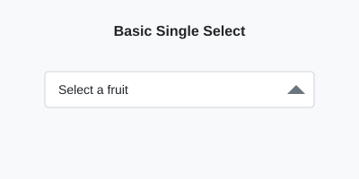
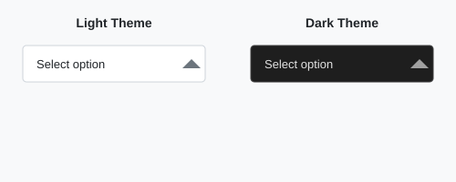
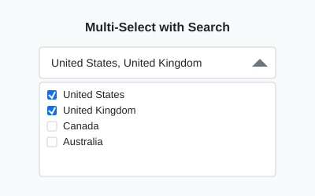
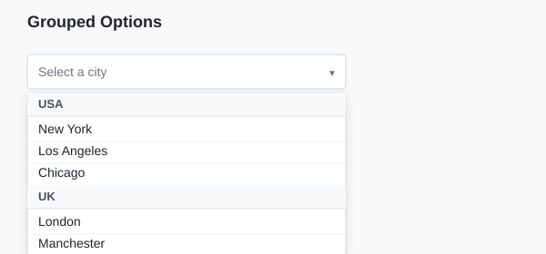
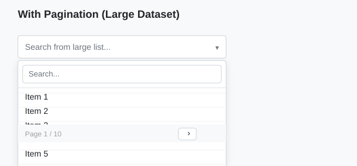
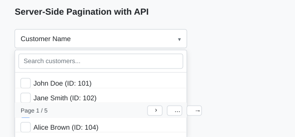
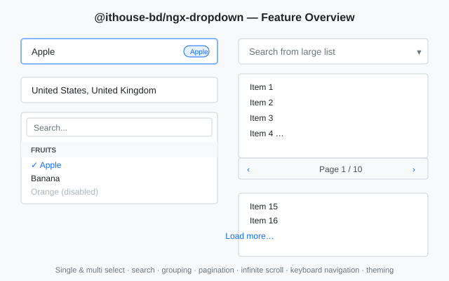

# @ithouse/ngx-dropdown Documentation

A modern, feature-rich Angular dropdown/select component built for global use with full theming support.

## Table of Contents

- [Features](#features)
- [Installation](#installation)
- [Quick Start](#quick-start)
- [Theming](#theming)
- [API Reference](#api-reference)
- [Usage Examples](#usage-examples)
- [Styling & Customization](#styling--customization)
- [Browser Support](#browser-support)
- [Contributing](#contributing)

## Features

| Feature | Status | Description |
|---------|--------|-------------|
| Single Select | ✅ | Basic dropdown selection |
| Multi-select | ✅ | Select multiple options with checkboxes |
| Searchable/Filterable | ✅ | Filter options by typing |
| Grouped Options | ✅ | Organize options into groups/categories |
| Pagination | ✅ | Handle large datasets with pagination buttons |
| Infinite Scroll | ✅ | Auto load-more on scroll (client- or server-side) |
| Keyboard Navigation | ✅ | Full keyboard support (arrows, Home/End, Enter, Escape) |
| Disabled Options | ✅ | Disable specific options |
| Disable Dropdown | ✅ | Disable the entire component |
| Select All/Clear All | ✅ | Bulk actions in multi-select mode |
| Clearable | ✅ | Clear current selection |
| Form Control Support | ✅ | Works with Reactive Forms & Template Driven Forms |
| Dark/Light Theme | ✅ | Built-in theme support with CSS variables |
| Customizable | ✅ | Highly customizable via CSS variables |

## Installation

### NPM
```bash
npm install @ithouse/ngx-dropdown
```

### Yarn
```bash
yarn add @ithouse/ngx-dropdown
```

### PNPM
```bash
pnpm add @ithouse/ngx-dropdown
```

## Quick Start

### 1. Import the Module

```typescript
import { NgModule } from '@angular/core';
import { BrowserModule } from '@angular/platform-browser';
import { NgxDropdownModule } from '@ithouse/ngx-dropdown';

import { AppComponent } from './app.component';

@NgModule({
  declarations: [AppComponent],
  imports: [
    BrowserModule,
    NgxDropdownModule
  ],
  bootstrap: [AppComponent]
})
export class AppModule { }
```

Or, if you use standalone components, import the component directly (requires **Angular 17+** — the template uses built-in `@if`/`@for` control flow):

```typescript
import { Component } from '@angular/core';
import { DropdownComponent } from '@ithouse/ngx-dropdown';

@Component({
  selector: 'app-root',
  standalone: true,
  imports: [DropdownComponent],
  templateUrl: './app.component.html'
})
export class AppComponent {}
```

### 2. Use in Template

```html
<ith-dropdown 
  [options]="options" 
  placeholder="Choose an option"
  (selectionChange)="onChange($event)">
</ith-dropdown>
```

### 3. Define Options

```typescript
import { Component } from '@angular/core';
import { DropdownOption } from '@ithouse/ngx-dropdown';

@Component({
  selector: 'app-root',
  templateUrl: './app.component.html'
})
export class AppComponent {
  options: DropdownOption[] = [
    { value: '1', label: 'Option 1' },
    { value: '2', label: 'Option 2' },
    { value: '3', label: 'Option 3' }
  ];

  onChange(event: any) {
    console.log('Selected:', event);
  }
}
```

> **Design Preview:** 
> *Basic single select dropdown in light theme*

## Theming

The dropdown comes with built-in support for light, dark, and system theme. It uses CSS custom properties for easy customization.

### Quick Theme Setup

Add `data-theme` attribute to your `html` or `body` element:

```html
<html data-theme="light">  <!-- or "dark" or "auto" -->
```

Or use the `dark` class:

```html
<html class="dark">
```

### Available Themes

| Theme | Usage | Description |
|-------|-------|-------------|
| `light` | `data-theme="light"` | Clean light theme (default) |
| `dark` | `data-theme="dark"` or `.dark` class | Modern dark theme for low-light environments |
| `auto`/`system` | `data-theme="auto"` or no attribute | Follows system preference via `prefers-color-scheme` |

> **Design Preview:** 
> *Light theme (left) vs Dark theme (right)*

### Theme Toggle Example

```typescript
// theme.service.ts
import { Injectable } from '@angular/core';

@Injectable({ providedIn: 'root' })
export class ThemeService {
  setTheme(theme: 'light' | 'dark' | 'auto') {
    document.documentElement.setAttribute('data-theme', theme);
    localStorage.setItem('theme', theme);
  }

  getTheme(): 'light' | 'dark' | 'auto' {
    return (localStorage.getItem('theme') as any) || 'auto';
  }

  initTheme() {
    this.setTheme(this.getTheme());
  }
}
```

```html
<div class="theme-switcher">
  <button (click)="setTheme('light')">☀️ Light</button>
  <button (click)="setTheme('dark')">🌙 Dark</button>
  <button (click)="setTheme('auto')">💻 System</button>
</div>
```

## API Reference

### Inputs

| Property | Type | Default | Description |
|----------|------|---------|-------------|
| `options` | `DropdownOption[]` | `[]` | Array of options to display in dropdown |
| `placeholder` | `string` | `'Select...'` | Placeholder text when no selection |
| `multiple` | `boolean` | `false` | Enable multi-selection mode |
| `searchable` | `boolean` | `true` | Enable search/filter functionality |
| `disabled` | `boolean` | `false` | Disable entire dropdown |
| `pageable` | `boolean` | `false` | Enable pagination (prev/next buttons) for large lists |
| `pageSize` | `number` | `10` | Number of options per page / per scroll chunk |
| `infiniteScroll` | `boolean` | `false` | Auto load-more on scroll; takes precedence over `pageable` |
| `hasMore` | `boolean` | `true` | (Server-side infinite scroll) whether more pages exist |
| `groupBy` | `string` | `undefined` | Property name to group options by |
| `showSelectAll` | `boolean` | `true` | Show "Select All" button in multi-select mode |
| `clearable` | `boolean` | `true` | Show clear button to reset selection |
| `closeOnSelect` | `boolean` | `true` | Auto-close dropdown after selection (single select only) |
| `maxHeight` | `string` | `'250px'` | Max height of the options list |
| `searchPlaceholder` | `string` | `'Search...'` | Placeholder for the search input |
| `noOptionsText` | `string` | `'No options found'` | Text shown when the filter yields no results |
| `bindLabel` | `string` | `undefined` | Property to display (defaults to 'label', falls back to 'name','text','title') |
| `bindValue` | `string` | `undefined` | Property for form value (if not set, uses 'value' or entire object) |
| `serverSide` | `boolean` | `false` | Enable server-side pagination/search for API calls |
| `totalItems` | `number` | `0` | Total items count for server-side pagination |
| `loading` | `boolean` | `false` | Show loading state |
| `loadingText` | `string` | `'Loading...'` | Text shown during loading |

### Outputs

| Event | Type | Description |
|-------|------|-------------|
| `selectionChange` | `EventEmitter<DropdownChangeEvent>` | Emits when selection changes |
| `searchChange` | `EventEmitter<string>` | Emits when search term changes |
| `openChange` | `EventEmitter<boolean>` | Emits when dropdown opens/closes |
| `pageChange` | `EventEmitter<number>` | Emits when the page changes (button pagination / server-side search reset) |
| `loadMore` | `EventEmitter<void>` | Emits (server-side infinite scroll) when the user reaches the end of the list |

### Keyboard Navigation

The dropdown implements the WAI-ARIA combobox pattern. When the trigger has focus:

| Key | Closed dropdown | Open dropdown |
|-----|-----------------|---------------|
| `ArrowDown` | Open, highlight first option | Highlight next option |
| `ArrowUp` | Open, highlight last option | Highlight previous option |
| `Home` / `End` | — | Highlight first / last option |
| `Enter` / `Space` | Open | Select highlighted option |
| `Escape` | — | Close dropdown |

Disabled options are skipped. Highlighted options scroll into view automatically.

### Interfaces

```typescript
interface DropdownOption {
  value: any;
  label: string;
  disabled?: boolean;
  group?: string;
  [key: string]: any; // Allow custom properties
}

interface DropdownConfig {
  placeholder?: string;
  searchable?: boolean;
  multiple?: boolean;
  disabled?: boolean;
  closeOnSelect?: boolean;
  maxHeight?: string;
  showSelectAll?: boolean;
  clearable?: boolean;
  searchPlaceholder?: string;
  noOptionsText?: string;
  loadingText?: string;
  pageable?: boolean;
  pageSize?: number;
  groupBy?: string;
  serverSide?: boolean;
  totalItems?: number;
  loading?: boolean;
  infiniteScroll?: boolean;
  hasMore?: boolean;
}

interface DropdownChangeEvent {
  value: any | any[];
  selectedItems: DropdownOption | DropdownOption[] | null;
}
```

## Usage Examples

### 1. Basic Usage with bindLabel/bindValue

> **Design Preview:** 
> *Basic single select dropdown in light theme*

#### bindLabel & bindValue Behavior

The dropdown supports flexible binding:

- **If `bindValue` specified** → Form control gets `option[bindValue]`
- **If `bindValue` not specified but `option.value` exists** → Form control gets `option.value`
- **If neither** → Form control gets the **entire option object**

- **If `bindLabel` specified** → Display shows `option[bindLabel]`
- **If `bindLabel` not specified** → Tries `option.label`, then `option.name`, `option.text`, `option.title`, else stringifies object

#### Examples

```html
<!-- Default behavior: if value property exists on option, it goes to form control -->
<ith-dropdown 
  [options]="options" 
  [formControl]="myControl">
</ith-dropdown>
```

```typescript
// Example: value property present
options = [
  { value: 1, label: 'Available' },
  { value: 2, label: 'Disabled', disabled: true },
  { value: 3, label: 'Also Available' },
];
// myControl value will be: 1, 2, or 3 (the 'value' property)
// Display shows 'label' property: 'Available', 'Disabled', 'Also Available'
```

```html
<!-- Custom binding with bindLabel and bindValue -->
<ith-dropdown 
  [options]="users" 
  bindLabel="fullName" 
  bindValue="id"
  [formControl]="userIdControl">
</ith-dropdown>
```

```typescript
// Example: custom properties
users = [
  { id: 101, fullName: 'John Doe', email: 'john@test.com' },
  { id: 102, fullName: 'Jane Smith', email: 'jane@test.com' },
];
// userIdControl value will be: 101 or 102 (bindValue 'id')
// Display shows fullName: 'John Doe' or 'Jane Smith' (bindLabel 'fullName')
```

```html
<!-- No bindLabel/bindValue, no standard fields - entire object goes to form control -->
<ith-dropdown 
  [options]="items" 
  [formControl]="myControl">
</ith-dropdown>
```

```typescript
// Example: completely custom structure
items = [
  { name: 'Product A', price: 100 },
  { name: 'Product B', price: 200 },
];
// If no bindLabel and no 'label'/'name' field, it falls back to stringifying
// If no bindValue and no 'value' field, the ENTIRE object goes to form control
// myControl value will be: { name: 'Product A', price: 100 } or { name: 'Product B', price: 200 }
// Display shows: "Product A" or "Product B" (since 'name' field exists)
```

### 2. Multi-select with Search

```html
<ith-dropdown 
  [options]="countries" 
  [multiple]="true"
  [searchable]="true"
  placeholder="Select countries">
</ith-dropdown>
```

> **Design Preview:** 
> *Multi-select with checkboxes and search functionality*

### 2. Grouped Options

```typescript
groupedOptions: DropdownOption[] = [
  { value: 'ny', label: 'New York', group: 'USA' },
  { value: 'la', label: 'Los Angeles', group: 'USA' },
  { value: 'london', label: 'London', group: 'UK' },
  { value: 'manchester', label: 'Manchester', group: 'UK' },
  { value: 'tokyo', label: 'Tokyo', group: 'Japan' },
];
```

```html
<ith-dropdown 
  [options]="groupedOptions" 
  [groupBy]="'group'"
  placeholder="Select a city">
</ith-dropdown>
```

> **Design Preview:** 
> *Options organized by groups with sticky headers*

### 4. With Pagination (Large Datasets)

```html
<ith-dropdown 
  [options]="largeDataset" 
  [pageable]="true"
  [pageSize]="15"
  [searchable]="true"
  placeholder="Search from 1000+ items">
</ith-dropdown>
```

> **Design Preview:** 
> *Pagination controls for handling large option lists* (kehrel png svg conversion dorkar)

### 5. With Infinite Scroll (Large Datasets)

Instead of prev/next buttons, options are revealed automatically as the user scrolls to the bottom. A "Load more…" button is rendered as a fallback.

**Client-side** (options are sliced locally and grown on scroll):

```html
<ith-dropdown 
  [options]="largeDataset" 
  [infiniteScroll]="true"
  [pageSize]="20"
  [searchable]="true"
  placeholder="Scroll to explore 1000+ items">
</ith-dropdown>
```

**Server-side** (each scroll chunk is fetched from your API):

```typescript
export class CustomerFormComponent {
  options = signal<any[]>([]);
  hasMorePages = signal(true);
  isLoading = signal(false);
  private page = 1;
  private search = '';

  onSearch(term: string) {
    this.search = term;
    this.page = 1;
    this.options.set([]);
    this.hasMorePages.set(true);
    this.fetchChunk();
  }

  loadNextPage() {
    if (this.isLoading() || !this.hasMorePages()) return;
    this.page++;
    this.fetchChunk();
  }

  private fetchChunk() {
    this.isLoading.set(true);
    this.http
      .get<{ items: any[]; hasMore: boolean }>('/api/customers', {
        params: { page: this.page, search: this.search },
      })
      .subscribe((res) => {
        this.options.update((cur) => [...cur, ...res.items]);
        this.hasMorePages.set(res.hasMore);
        this.isLoading.set(false);
      });
  }
}
```

```html
<ith-dropdown 
  [options]="options()"
  [infiniteScroll]="true"
  [serverSide]="true"
  [loading]="isLoading()"
  [hasMore]="hasMorePages()"
  bindLabel="name"
  bindValue="id"
  (loadMore)="loadNextPage()"
  (searchChange)="onSearch($event)">
</ith-dropdown>
```

> **Note:** `infiniteScroll` takes precedence over `pageable` when both are set.

### 6. With Disabled Options

```typescript
options: DropdownOption[] = [
  { value: 'active1', label: 'Active Option' },
  { value: 'disabled1', label: 'Disabled Option', disabled: true },
  { value: 'active2', label: 'Another Active Option' },
];
```

```html
<ith-dropdown [options]="options" placeholder="Select option"></ith-dropdown>
```

### 7. Server-Side Pagination with API (for large datasets)

> **Design Preview:** 
> *Server-side pagination with API calls*

When you have large datasets from an API, use server-side mode:

```html
<ith-dropdown 
  [options]="apiOptions"
  [searchable]="true"
  [pageable]="true"
  [serverSide]="true"
  [totalItems]="totalCount"
  [loading]="isLoading"
  [loadingText]="'Loading customers...'"
  bindLabel="name"
  bindValue="id"
  [formControl]="customerControl"
  (searchChange)="onSearch($event)"
  (pageChange)="onPageChange($event)">
</ith-dropdown>
```

```typescript
import { HttpClient } from '@angular/common/http';
import { Component, signal, OnInit } from '@angular/core';

@Component({
  selector: 'app-customer-form',
  standalone: true,
  imports: [ReactiveFormsModule, DropdownComponent],
  template: `
    <form [formGroup]="form">
      <label class="form-label">Select Customer</label>
      <ith-dropdown 
        [options]="apiOptions()"
        [searchable]="true"
        [pageable]="true"
        [serverSide]="true"
        [totalItems]="totalCount()"
        [loading]="isLoading()"
        [loadingText]="'Loading customers...'"
        bindLabel="name"
        bindValue="id"
        formControlName="customerId"
        (searchChange)="onSearch($event)"
        (pageChange)="onPageChange($event)">
      </ith-dropdown>
    </form>
  `
})
export class CustomerFormComponent {
  form = new FormGroup({
    customerId: new FormControl(null)
  });
  
  apiOptions = signal<any[]>([]);
  totalCount = signal(0);
  isLoading = signal(false);
  
  private currentPage = 1;
  private searchTerm = '';
  
  constructor(private http: HttpClient) {
    this.loadCustomers(); // Initial load
  }
  
  onSearch(term: string) {
    this.searchTerm = term;
    this.currentPage = 1;
    this.loadCustomers();
  }
  
  onPageChange(page: number) {
    this.currentPage = page;
    this.loadCustomers();
  }
  
  loadCustomers() {
    this.isLoading.set(true);
    this.http.get<{items: any[], total: number}>('/api/customers', {
      params: { page: this.currentPage, search: this.searchTerm }
    }).subscribe(res => {
      this.apiOptions.set(res.items);
      this.totalCount.set(res.total);
      this.isLoading.set(false);
    });
  }
  
  onSubmit() {
    console.log('Selected customer:', this.form.value.customerId);
  }
}
```

> **Note:** In server-side mode:
> - Pagination and search are handled by the API, not locally
> - Use `pageChange` event to fetch next page from API
> - Use `totalItems` to show correct pagination UI
> - Use `loading` to show loading state

### 8. Reactive Forms Integration

```typescript
import { FormBuilder, FormGroup } from '@angular/forms';

export class MyComponent {
  form: FormGroup;

  constructor(private fb: FormBuilder) {
    this.form = this.fb.group({
      country: [['us', 'uk']], // Multi-select with initial values
      city: ['ny'] // Single select
    });
  }

  onSubmit() {
    console.log(this.form.value);
  }
}
```

```html
<form [formGroup]="form" (ngSubmit)="onSubmit()">
  <ith-dropdown 
    [options]="countries" 
    [multiple]="true"
    formControlName="country">
  </ith-dropdown>
  
  <ith-dropdown 
    [options]="cities" 
    formControlName="city">
  </ith-dropdown>
  
  <button type="submit">Submit</button>
</form>
```

## Styling & Customization

### CSS Variables

You can override the default theme variables to create your own custom theme.

```css
/* Custom theme */
.my-custom-theme .ith-dropdown {
  --ith-bg: #f9f9f9;
  --ith-text: #333333;
  --ith-border: #e0e0e0;
  --ith-border-focus: #6c5ce7;
  --ith-shadow-focus: rgba(108, 92, 231, 0.25);
  --ith-hover-bg: #f1f1f1;
  --ith-selected-bg: #f3f0ff;
  --ith-selected-text: #6c5ce7;
  --ith-selected-hover-bg: #e9e5ff;
}
```

```html
<div class="my-custom-theme">
  <ith-dropdown [options]="options"></ith-dropdown>
</div>
```

### Available CSS Variables

| Variable | Light Default | Dark Default | Purpose |
|----------|---------------|--------------|---------|
| `--ith-bg` | `#ffffff` | `#1e1e1e` | Background color |
| `--ith-text` | `#212529` | `#e1e1e1` | Text color |
| `--ith-border` | `#ced4da` | `#3d3d3d` | Border color |
| `--ith-border-focus` | `#86b7fe` | `#4dabf7` | Focus border color |
| `--ith-shadow-focus` | `rgba(13, 110, 253, 0.25)` | `rgba(77, 171, 247, 0.25)` | Focus shadow |
| `--ith-hover-bg` | `#f8f9fa` | `#2d2d2d` | Hover background |
| `--ith-selected-bg` | `#e7f1ff` | `#1a365d` | Selected item background |
| `--ith-selected-text` | `#0d6efd` | `#63b3ed` | Selected item text |
| `--ith-placeholder` | `#6c757d` | `#a0a0a0` | Placeholder text color |
| `--ith-panel-shadow` | `0 0.5rem 1rem rgba(0, 0, 0, 0.15)` | `0 0.5rem 1rem rgba(0, 0, 0, 0.5)` | Dropdown panel shadow |

### Class-based Customization

You can also target specific classes for more granular control:

```css
/* Customize trigger */
.ith-dropdown-trigger {
  border-radius: 8px;
  padding: 10px 14px;
}

/* Customize options */
.ith-dropdown-option {
  font-size: 14px;
}

/* Customize selected state */
.ith-dropdown-option-selected {
  font-weight: 600;
}
```

## Design Guidelines

For the best user experience, follow these guidelines:

- **Width**: The dropdown takes full width by default. Use container constraints as needed.
- **Height**: Default max-height is 250px. Adjust via the `maxHeight` input for your use case.
- **Search**: Enable search for lists with 10+ items for better UX.
- **Pagination / Infinite Scroll**: For lists with 50+ items, use `pageable` (prev/next buttons) or `infiniteScroll` (auto load-more) to improve performance. Prefer `infiniteScroll` for a more modern, less cluttered UX.
- **Grouping**: Use grouping when options have logical categories.
- **Accessibility**: The component includes ARIA attributes for screen readers.

> **Design Preview:** 
> *Overview of all dropdown features in action* (kehrel png svg conversion dorkar)

## Browser Support

| Browser | Version |
|---------|---------|
| Chrome | Latest |
| Firefox | Latest |
| Safari | Latest |
| Edge | Latest |
| Opera | Latest |

## Screenshots Guide

To make the documentation even better, add these screenshots to `docs/images/` folder:

- `basic-dropdown.svg` - Basic single select (created)
- `multiselect-dropdown.svg` - Multi-select with checkboxes (created)
- `grouped-dropdown.svg` - Grouped options (created)
- `theme-comparison.svg` - Light vs Dark side by side (created)
- `paginated-dropdown.svg` - With pagination (TODO: create)
- `pagination-serverside.svg` - Server-side pagination with API calls (TODO: create)
- `all-features-overview.svg` - Comprehensive view (TODO: create)
- `form-integration.svg` - With Angular forms (TODO: create)

## Contributing

Contributions are welcome! Please feel free to submit a Pull Request.

## License

MIT © iTHouse
