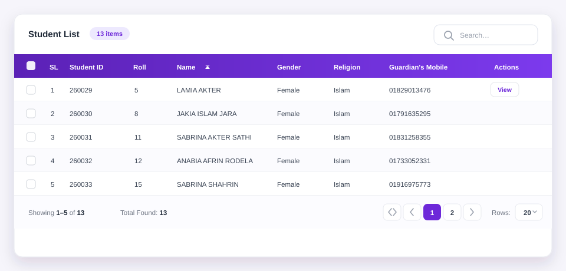

# @ithouse-bd/ngx-table — Documentation

Complete reference for `<ith-table>`: every input, output, template slot and recipe.

## Contents

- [Requirements](#requirements)
- [Installation](#installation)
- [Basic usage](#basic-usage)
- [Columns](#columns)
- [Sorting](#sorting)
- [Search and filters](#search-and-filters)
- [Pagination](#pagination)
- [Selection](#selection)
- [Row actions](#row-actions)
- [Custom templates](#custom-templates)
- [Copy, context menu & presets](#copy-context-menu--presets)
- [Header menu, resize and reorder](#header-menu-resize-and-reorder)
- [Named views](#named-views)
- [Row detail](#row-detail)
- [CSV and Excel export](#csv-and-excel-export)
- [Footer totals](#footer-totals)
- [Keyboard grid](#keyboard-grid)
- [Loading and empty states](#loading-and-empty-states)
- [Server-side mode](#server-side-mode)
- [Programmatic API](#programmatic-api)
- [Accessibility](#accessibility)
- [Performance](#performance)
- [Troubleshooting](#troubleshooting)
- [Full input/output reference](#full-inputoutput-reference)



## Requirements

- Angular **20 or newer** (standalone components, signal inputs, `model()`)
- No CSS framework required; the component ships its own scoped styles

Install:

```bash
npm install @ithouse-bd/ngx-table
```

The library is standalone-only; import the component and any template directives you use:

```typescript
import { TableComponent, TableCellDirective } from '@ithouse-bd/ngx-table';
```

> **Projected templates:** the `ithTableCell`, `ithTableHeader`, `ithTableFilter`,
> `ithTableRowActions`, `ithTableToolbar`, `ithTableFooter`, `ithTableEmpty` and
> `ithTableRowMenu` directives are used in *your* template, so import the ones you use into
> your component.

## Basic usage

```typescript
interface Product {
  id: number;
  name: string;
  category: string;
  price: number;
  stock: number;
  active: boolean;
}

readonly columns: TableColumn<Product>[] = [
  { key: 'name', header: 'Product', minWidth: '200px' },
  { key: 'category', header: 'Category' },
  { key: 'price', header: 'Price', align: 'right', formatter: (v) => `$${Number(v).toFixed(2)}` },
  { key: 'stock', header: 'Stock', align: 'center' },
  { key: 'active', header: 'Active', formatter: (v) => (v ? 'Yes' : 'No') },
];
```

```html
<ith-table
  title="Products"
  countSuffix="products"
  [data]="products"
  [columns]="columns"
  [pageSize]="20">
</ith-table>
```

Defaults that matter:

| Option | Default |
| --- | --- |
| `mode` | `client` |
| `keyField` | `id` |
| `selectionMode` | `none` |
| `sortable` | `true` (per column) |
| `searchable` | `true` |
| `pageSize` | `10` |
| `pageSizeOptions` | `[10, 20, 50, 100]` |
| `hoverable` | `true` |
| `showToolbar` / `showFooter` | `true` |
| `showPagination` / `showPageSize` / `showFirstLast` | `true` |

## Columns

`TableColumn<T>` controls both data access and rendering:

| Field | Type | Description |
| --- | --- | --- |
| `key` | `string` | Unique id. Also the template name (`ithTableCell="key"`). |
| `header` | `string` | Header label; defaults to `key`. |
| `field` | `string` | Dot-path to the value, e.g. `customer.name`. Defaults to `key`. |
| `sortable` | `boolean` | Per-column override of the table-level `sortable`. |
| `searchable` | `boolean` | Include in global search (default `true`). |
| `filterable` | `boolean` | Show a control in the filter row (default `true`). |
| `filterType` | `'text' \| 'number' \| 'date' \| 'select'` | Control used by the filter (default `text`). |
| `filterOptions` | `{ label, value }[]` | Options of a `select` filter. |
| `filterPlaceholder` | `string` | Placeholder for this column's control. |
| `filterPredicate` | `(cellValue, filterValue, row) => boolean` | Custom matching rule (wins over `filterType`). |
| `align` | `'left' \| 'center' \| 'right'` | Header and cell alignment. |
| `width`, `minWidth` | `string` | CSS sizing, e.g. `'120px'`, `'20%'`. |
| `hidden` | `boolean` | Keep the config but hide the column. |
| `headerClass`, `cellClass` | `string` \| `(row, index) => string \| string[] \| object` | Extra classes. |
| `formatter` | `(value, row, index) => string \| number` | Display value; also used for search/filter matching. |
| `sortFn` | `(a: T, b: T) => number` | Custom ascending comparator. |
| `searchValue` | `(row: T) => string` | Custom text for the global search. |
| `filterValue` | `(row: T) => string` | Custom text for the column filter. |
| `tooltip` | `boolean` | Show the full cell text as a native tooltip (default `true`). |
| `sticky` | `'start' \| 'end'` | Keep the column pinned while scrolling horizontally (declare a `width`). |

Nested values work out of the box:

```typescript
{ key: 'name', field: 'customer.name', header: 'Customer' }
```

## Sorting

Clicking a sortable header cycles **ascending → descending → unsorted**. Bind `sort` for
two-way control or listen to `sortChange`:

```html
<ith-table
  [data]="rows"
  [columns]="columns"
  [sort]="sort"
  (sortChange)="sort = $event">
</ith-table>
```

```typescript
sort: TableSort | null = { key: 'price', direction: 'desc' };
```

`TableSort` is `{ key: string; direction: 'asc' | 'desc' }`. Disable sorting table-wide with
`[sortable]="false"`, or per column with `{ sortable: false }`.

### Custom comparators

```typescript
{
  key: 'priority',
  header: 'Priority',
  sortFn: (a, b) => priorityWeight[a.priority] - priorityWeight[b.priority],
}
```

Sorting compares raw values by default: numbers numerically, dates by time, strings with
`localeCompare` (`numeric: true`, case-insensitive).

## Search and filters

`searchable` (default `true`) renders a search input in the toolbar. It matches **any**
searchable column; searching is debounced by Angular change detection, not by a timer, so
bind `search` in server mode when you need throttling.

```html
<ith-table [data]="rows" [columns]="columns" [(search)]="term"></ith-table>
```

### Per-column filters

```html
<ith-table [data]="rows" [columns]="columns" [showFilters]="true"></ith-table>
```

A second header row appears with a control for **every column**. Each column decides what
it renders through `filterType`:

```typescript
const columns: TableColumn<Order>[] = [
  // text (default): keeps rows whose display text contains the input
  { key: 'customer', header: 'Customer' },
  { key: 'customer', field: 'customer.name', header: 'Customer', filterPlaceholder: 'Search…' },

  // number: exact match on the numeric value
  { key: 'quantity', header: 'Qty', filterType: 'number' },

  // date: exact match on yyyy-mm-dd
  { key: 'createdAt', field: 'createdAt', header: 'Created', filterType: 'date' },

  // select: exact match, rendered as a dropdown
  {
    key: 'status',
    header: 'Status',
    filterType: 'select',
    filterOptions: [
      { label: 'Paid', value: 'paid' },
      { label: 'Pending', value: 'pending' },
    ],
  },

  // custom matching: any rule you like
  {
    key: 'total',
    header: 'Total',
    filterType: 'number',
    filterPredicate: (value, term) => Number(value) >= Number(term), // “total ≥ term”
  },

  // no filter control at all
  { key: 'notes', header: 'Notes', filterable: false },
];
```

Select filters show an empty option labelled `[filterAllLabel]="'All'"`. Opt a column out
with `{ filterable: false }`, hide the whole row with `[showFilters]="false"` (the default),
or replace one control with your own template:

```html
<ng-template ithTableFilter="status" let-value let-setFn="setValue">
  <select class="my-filter" [value]="value" (change)="setFn($any($event.target).value)">
    <option value="">Everything</option>
    <option value="paid">Paid</option>
    <option value="pending">Pending</option>
  </select>
</ng-template>
```

Context: `$implicit`/`value` (current filter text), `column`, `setValue(value: string)`.
Projected templates are styled by **your** component, so give them their own classes.

Filters are exposed as `filters` (`Record<columnKey, string>`), two-way bindable, and as the
`filterChange` output:

```html
<ith-table [(filters)]="filters" (filterChange)="load()"></ith-table>
```

In **client mode** search and filters reset the table to page 1 automatically. In **server
mode** nothing is filtered locally and the table never moves the page on its own: it passes
the whole `filterChange` record to you, and your handler should reset the page while it
fetches the filtered page back.

The empty state offers a “Clear search & filters” action.

Matching rules: `text` matches the formatted cell text, `number` compares numerically
(`12`, `12.0` and `012` all match 12), `date` compares the calendar date so an ISO string
such as `2026-10-05T23:00:00Z` is never shifted by a time zone, and `select` matches the
option value exactly.

## Pagination

The footer shows `Showing 1–10 of 13`, the `totalLabel` count, a numbered page window,
first/previous/next/last buttons and a rows-per-page selector.

```html
<ith-table
  [data]="rows"
  [columns]="columns"
  [(page)]="page"
  [(pageSize)]="pageSize"
  [pageSizeOptions]="[5, 10, 25, 100]"
  [maxPageButtons]="7"
  (pageChange)="onPage($event)">
</ith-table>
```

`pageChange` emits the new page number, `pageSizeChange` the new page size. All three of
`page`, `pageSize` and `pageSizeOptions` can be bound; hide parts of the footer with
`[showPagination]="false"`, `[showPageSize]="false"` or `[showFirstLast]="false"`.

If data shrinks, the current page is clamped to the last available page automatically.

## Selection

```html
<ith-table
  [data]="rows"
  [columns]="columns"
  selectionMode="multi"
  [(selected)]="selected">
</ith-table>
```

| Input | Description |
| --- | --- |
| `selectionMode` | `'none'`, `'single'` or `'multi'` |
| `selectAllScope` | `'page'` (default) selects the visible page, `'all'` selects every filtered row |
| `selectOnRowClick` | Click anywhere on a row to toggle it (default `false`) |
| `keyField` | Row identity; selection survives sorting, filtering and paging by key |
| `selected` | Two-way bindable array of selected rows |

`selectedChange` emits the selected rows. Header checkbox reflects `allPageSelected()` and
shows an indeterminate state when only some rows of the page are selected.

Selection across pages is preserved by key. For server mode, keys are compared to the rows
currently in `selected`, so keep the objects you put there.

Public helpers: `toggleRow(row, checked)`, `toggleAll(checked)`, `selectRow(row)`,
`deselectRow(row)`, `clearSelection()`, `isSelected(row)`.

## Row actions

```typescript
readonly actions: TableRowAction<Order>[] = [
  { id: 'view', label: 'View', icon: '👁' },
  { id: 'ship', label: 'Ship', disabled: (row) => row.status !== 'paid', hidden: (row) => row.cancelled },
  { id: 'cancel', label: 'Cancel', class: 'is-danger' },
];
```

```html
<ith-table
  [data]="orders"
  [columns]="columns"
  [rowActions]="actions"
  actionsHeader="Actions"
  actionsWidth="180px"
  (actionClick)="onAction($event)">
</ith-table>
```

```typescript
onAction(event: TableActionEvent<Order>): void {
  const { action, row, index } = event;
  if (action.id === 'view') this.router.navigate(['/orders', row.id]);
}
```

The actions column is rendered only when `rowActions` is non-empty **or** a
`#ithTableRowActions` template exists. Buttons stop click propagation, so row clicks (and
`selectOnRowClick`) are not triggered.

## Custom templates

All templates are optional. Import the matching directives in your component.

### Cell — `ithTableCell="key"`

```html
<ng-template ithTableCell="status" let-row let-value="value" let-index="index">
  <span class="badge" [class.bg-success]="value === 'active'">{{ value }}</span>
</ng-template>
```

Context: `$implicit`/`row`, `column`, `value`, `index`.

### Header — `ithTableHeader="key"`

```html
<ng-template ithTableHeader="price" let-column="column">
  <span class="d-inline-flex align-items-center gap-1">
    {{ column.header }} <small class="text-muted">USD</small>
  </span>
</ng-template>
```

Context: `$implicit`/`column`.

### Filter control — `ithTableFilter="key"`

```html
<ng-template ithTableFilter="customer" let-value let-setFn="setValue" let-column="column">
  <input class="search" [value]="value" (input)="setFn($any($event.target).value)" />
</ng-template>
```

Context: `$implicit`/`value`, `column`, `setValue`. Changing the value behaves exactly like
the built-in control (server mode emits `filterChange`, page resets to 1).

### Row actions — `ithTableRowActions`

```html
<ng-template ithTableRowActions let-row let-index="index">
  <button type="button" class="btn btn-sm" (click)="edit(row)">Edit</button>
  <button type="button" class="btn btn-sm btn-danger" (click)="remove(row, index)">Delete</button>
</ng-template>
```

Context: `$implicit`/`row`, `index`.

### Toolbar — `ithTableToolbar`

Rendered next to the title and count badge:

```html
<ng-template ithTableToolbar let-total="total" let-selected="selected">
  <button class="btn btn-sm btn-primary" (click)="exportRows()">
    Export {{ total }}
  </button>
  @if (selected.length) {
    <button class="btn btn-sm btn-outline-danger" (click)="bulkDelete()">
      Delete {{ selected.length }}
    </button>
  }
</ng-template>
```

Context: `rows` (current page), `total`, `selected`, `search`.

### Footer — `ithTableFooter`

Replaces the default summary **only**; pagination controls stay. Context adds `page`,
`pageSize`, `pageCount`:

```html
<ng-template ithTableFooter let-page="page" let-page-count="pageCount" let-total="total">
  <span>Page {{ page }} of {{ pageCount }} — {{ total }} records</span>
</ng-template>
```

### Empty — `ithTableEmpty`

```html
<ng-template ithTableEmpty>
  <div class="text-center py-4">
    <p class="mb-2">Nothing here yet.</p>
    <button class="btn btn-primary" (click)="create()">Create the first record</button>
  </div>
</ng-template>
```

## Copy, context menu & presets

### Copy

```html
<ith-table [data]="rows" [columns]="columns" [copyable]="true"
           (cellCopy)="onCopy($event)"></ith-table>
```

- A copy button appears on cell hover; `Ctrl`/`Cmd` + `C` copies the focused cell too.
- `(cellCopy)` emits `{ value, row, index, column }`; `column` is `null` when a full row was
  copied with `copyRow(row, index)`.

### Right-click menu

```html
<ith-table [data]="rows" [columns]="columns">
  <ng-template ithTableRowMenu let-row let-index="index">
    <button type="button" (click)="open(row)">Open</button>
    <button type="button" (click)="remove(row, index)">Delete</button>
  </ng-template>
</ith-table>
```

- Right-click or `Shift+F10` / the context-menu key emits `rowContextMenu`
  (`{ row, index, x, y, event }`) and renders the template in a fixed panel at the pointer.
- The panel closes on outside click or `Escape`; `closeRowMenu()` closes it from code.
- Without an `ithTableRowMenu` template the event is still emitted (for your own popover)
  and the browser menu is left alone.

### Column visibility, density and presets

```html
<ith-table [data]="rows" [columns]="columns"
           [showColumnPicker]="true"
           [showDensityToggle]="true"
           storageKey="students-table"
           (columnsChange)="onColumns($event)"
           (densityChange)="onDensity($event)"></ith-table>
```

- The "Columns" popover toggles visibility without touching the column config; at least one
  column always stays visible.
- With `storageKey`, the whole layout is restored from `localStorage` on the next visit:
  hidden columns, density, order, widths and pinning (the stored JSON is versioned, and an old
  1.0.0 `{ hidden, density }` value is still read). Call `resetColumns()` to clear it.
- `dense` still forces compact rows; the toggle only switches the runtime density.

### Header menu, resize and reorder

```html
<ith-table [data]="rows" [columns]="columns"
           [resizable]="true" [reorderable]="true"
           [showColumnMenu]="true"
           (columnStateChange)="save($event)"></ith-table>
```

- Every header shows a `⋮` button (on hover, or always on focus) opening a menu with sort
  ascending/descending, clear sort, pin to left/right, unpin, fit to content and hide column.
  Each item respects the column flags: `sortable`, `pinnable`, `hideable`.
- All popovers are rendered with `position: fixed` and positioned from the trigger's
  rectangle, so the toolbar's horizontal scroll box and the table's `overflow` can never clip
  them.
- `resizable` adds a pointer drag handle on the right edge of each header (minimum 56 px);
  `autosizeColumn(key)` or "Fit to content" sizes a column from its widest rendered value.
- `reorderable` drags a header onto another header; hidden columns keep their slot.
- `columnStateChange` emits `TablePresetState` — `{ hidden, density, order, widths, pinned }` —
  whenever the user changes the layout.
- Per-column opt-outs: `sticky: 'start' | 'end'` (initial pin), `pinnable: false`,
  `hideable: false`.

### Named views

```html
<ith-table [data]="rows" [columns]="columns" [showViews]="true"
           storageKey="orders-table"></ith-table>
```

The Views menu lists saved layouts ("Compact view", "Finance view" …), lets the user save the
current layout under a name, apply one with a click and delete one with `×`. Views live in the
same `storageKey` entry, and the active view stays highlighted.

### Filter chips

When `search()` or any column filter is active, `.ith-table-chips` shows one removable chip per
filter plus "Clear all". `showFilterChips` (default `true`) disables the row; `removeChip()` and
`clearQuery()` are also available programmatically.

### Selection bar

```typescript
bulk: TableSelectionAction<Row>[] = [
  { id: 'export', label: 'Export selected' },
  { id: 'delete', label: 'Delete', class: 'is-danger' },
];
```

```html
<ith-table [data]="rows" [columns]="columns" selectionMode="multi"
           [selectionActions]="bulk" (selectionAction)="run($event)"></ith-table>
```

As soon as one row is selected a bar appears above the table with the count, your actions and
"Clear selection". `(selectionAction)` emits `{ action, rows }`.

### Row detail

```html
<ith-table [data]="rows" [columns]="columns" rowDetailTrigger="button">
  <ng-template ithTableRowDetail let-row let-close="close">
    <dl class="detail">
      <dt>Email</dt><dd>{{ row.email }}</dd>
    </dl>
    <button type="button" (click)="close()">Close</button>
  </ng-template>
</ith-table>
```

- `rowDetailTrigger="button"` adds a chevron cell (rotates when open); `"row"` expands on row
  click; `"none"` disables expansion.
- The panel renders on its own full-width row under the row, and the template receives
  `{ $implicit, row, index, close }`.

### CSV and Excel export

```html
<ith-table [data]="rows" [columns]="columns" [showExport]="true"
           exportFileName="orders"
           (csvExport)="onCsv($event)"
           (exportFile)="onFile($event)"></ith-table>
```

`showExport` renders one toolbar button that opens a two-item menu:

| Item | Method | Result |
| --- | --- | --- |
| **Excel** | `downloadExcel()` / `toExcel()` | `.xlsx` workbook: bold frozen header row, autofilter, sized columns |
| **CSV** | `downloadCsv()` / `toCsv()` | `.csv`, UTF-8 with BOM so Excel keeps the encoding |

- Both paths write the visible columns in the user's order and the formatted cell text, and
  use the selected rows when there is a selection — otherwise every filtered row (not just the
  current page).
- `toCsv()` returns the text, `toExcel()` returns a `Blob`; `exportAs('csv' | 'xlsx')` runs the
  same logic as the menu. `(csvExport)` emits the CSV string, `(exportFile)` emits
  `{ format, fileName, blob, rows }` for both formats (upload it to your API instead of saving).
- The `.xlsx` writer (`buildXlsxBlob()` from the package) is a small ZIP + OOXML writer with no
  runtime dependency; it is exported separately in case you want to reuse it.
- CSV values containing `,` `;` `"` or a newline are quoted and escaped.
- Excel cells are written as text, so leading zeros in codes such as `260029` survive.

### Footer totals

```typescript
columns: TableColumn<Order>[] = [
  { key: 'customer', header: 'Customer' },
  { key: 'total', header: 'Total', align: 'right', aggregate: 'sum' },
  { key: 'qty', header: 'Qty', aggregate: { type: 'avg', label: 'Average' } },
  { key: 'id', header: '#', aggregate: 'count' },
];
```

`sum`, `avg`, `min`, `max` and `count` are computed over the filtered rows (the loaded page in
server mode) and rendered in a `<tfoot>` row that keeps the column alignment, sticky columns
and the density. `aggregate.label` renames the caption and `aggregate.format(value)` controls
the number formatting.

### Keyboard grid

`keyboardNavigation` (default `true`) gives the body a single tab stop and grid navigation:

| Key | Action |
| --- | --- |
| `↑` `↓` `←` `→` | Move one cell |
| `Home` / `End` | First / last cell of the row |
| `Ctrl+Home` / `Ctrl+End` | First cell / last cell of the page |
| `PageUp` / `PageDown` | Move one page of rows |
| `Space` | Toggle selection of the row |
| `Ctrl/Cmd+C` | Copy the focused cell (with `copyable`) |
| `Shift+F10` / context-menu key | Emit `rowContextMenu` |

### Sticky columns and tooltips

```typescript
columns: TableColumn<Row>[] = [
  { key: 'name', header: 'Name', width: '220px', sticky: 'start' },
  { key: 'email', header: 'Email' },
  { key: 'notes', header: 'Notes', tooltip: true },
];
```

- `sticky: 'start' | 'end'` pins that column; declare a pixel `width` so the next sticky
  column can be offset.
- `[stickySelection]="true"` / `[stickyActions]="true"` pin the checkbox and actions columns.
- `tooltip: false` disables the native title for a column.

## Loading and empty states

```html
<ith-table
  [data]="rows"
  [columns]="columns"
  [loading]="loading()"
  loadingText="Fetching orders…"
  emptyText="No orders for this period">
</ith-table>
```

- With no rows, a spinner and `loadingText` replace the empty state.
- With rows, a translucent overlay keeps the current rows visible while loading.
- `hasQuery()` in the empty state switches the message to “No records match your search.”
  and offers a clear action.

## Server-side mode

```typescript
readonly pageRows = signal<Order[]>([]);
readonly total = signal(0);
readonly loading = signal(false);
readonly page = signal(1);
readonly pageSize = signal(10);
readonly sort = signal<TableSort | null>({ key: 'createdAt', direction: 'desc' });
readonly search = signal('');

constructor() {
  effect(() => {
    // Any query change triggers a reload; signals make this zoneless-safe.
    void this.fetch(this.page(), this.pageSize(), this.sort(), this.search());
  });
}

private async fetch(page: number, pageSize: number, sort: TableSort | null, search: string) {
  this.loading.set(true);
  const result = await this.api.orders({ page, pageSize, sort, search });
  this.pageRows.set(result.items);
  this.total.set(result.total);
  this.loading.set(false);
}
```

```html
<ith-table
  mode="server"
  [data]="pageRows()"
  [total]="total()"
  [loading]="loading()"
  [columns]="columns"
  [page]="page()"
  [pageSize]="pageSize()"
  [sort]="sort()"
  [search]="search()"
  (pageChange)="page.set($event)"
  (pageSizeChange)="pageSize.set($event); page.set(1)"
  (sortChange)="sort.set($event)"
  (searchChange)="search.set($event); page.set(1)">
</ith-table>
```

Notes:

- In server mode the table renders exactly `[data]`; it never slices or re-sorts.
- `[total]` drives the page count and the footer range. Fall back to `data.length` when it is `0`.
- The table owns the page in **client** mode only (query changes restart at page 1). In
  server mode reset `page` yourself in the `searchChange` / `filterChange` /
  `pageSizeChange` handlers — that keeps a query change to a single request.
- `selectAllScope="all"` can only select the rows you have loaded; for true “select all”
  keep a server-side flag instead.

## Programmatic API

```typescript
@ViewChild(TableComponent) table!: TableComponent<Order>;
```

| Method | Description |
| --- | --- |
| `goToPage(page)` | Clamp and navigate |
| `nextPage()` / `previousPage()` / `firstPage()` / `lastPage()` | Navigation helpers |
| `toggleSort(column)` | Cycle a column's sort state |
| `toggleRow(row, checked)` / `toggleAll(checked)` | Selection |
| `selectRow(row)` / `deselectRow(row)` / `clearSelection()` | Selection helpers |
| `isSelected(row)` / `rowKey(row)` | Selection inspection |
| `clearSearch()` / `clearFilters()` / `clearQuery()` | Reset search state |
| `setColumnVisible(key, visible)` / `canHide(key)` | Column visibility |
| `resetColumns()` | Restore the default layout |
| `pinColumn(key, 'start' \| 'end' \| null)` | Runtime pinning |
| `autosizeColumn(key)` | Fit a column to its content |
| `moveColumn(from, to)` | Reorder two columns |
| `setDensity(density)` / `toggleDensity()` | Comfortable vs compact rows |
| `toggleRowDetail(row)` / `isRowExpanded(row)` | Row detail panel |
| `toCsv()` / `toExcel()` | CSV text / `.xlsx` blob |
| `downloadCsv()` / `downloadExcel()` / `exportAs(format)` | Downloads |
| `saveView()` / `applyView(name)` / `deleteView(name, event)` | Named layouts |
| `toggleColumnPicker()` / `toggleViews()` | Open the toolbar popovers |

Expose `sort`, `search`, `page`, `pageSize`, `selected` and `filters` publicly to reset
them from the parent.

## Accessibility

- Native `<table>`, `<thead>`/`<tbody>`, `<th scope="col">` markup.
- `aria-sort` on sortable headers (`ascending` / `descending` / `none`).
- Header and row checkboxes have explicit `aria-label`s; the header checkbox supports the
  indeterminate state.
- Pagination is a `<nav aria-label="Pagination">` with labelled first/previous/next/last
  buttons and `aria-current="page"` on the active page number.
- Sort headers and page buttons are real `<button>`s, so keyboard and screen readers work.
- Clickable rows (`rowClickable` / `selectOnRowClick`) are focusable and activate with
  `Enter` or `Space`, exactly like a mouse click.
- Selectable rows expose `aria-selected`; the header checkbox reflects “all on page” and
  the indeterminate state.
- `aria-busy` reflects `loading`, the loading/empty cell is `aria-live="polite"`, and
  `aria-label` names the table (`ariaLabel` input).
- `prefers-reduced-motion` disables row, button and input transitions.

## Performance

- Set `keyField` to a real unique field so `@for` tracks rows by key.
- Use `mode="server"` for large datasets instead of paging thousands of rows in the browser.
- Provide `track`-friendly stable row objects; the table never mutates your array.
- Avoid heavy work inside `formatter` / `cellClass` callbacks; they run per rendered cell.

## Troubleshooting

**Template directives are ignored / “not a known property”**
Import `TableCellDirective` (and friends) into the component that declares the template.

**Styles don’t show up**
Component styles are scoped; do not set `encapsulation: ViewEncapsulation.None` on the
consumer and avoid `display: none` on the host. The table needs its host `display: block`.

**Angular budget warning for component styles**
The table stylesheet is ~36 kB uncompressed (~6 kB gzipped). If your Angular project uses
the default `anyComponentStyle` budget (8 kB), raise it:

```json
{
  "type": "anyComponentStyle",
  "maximumWarning": "16kb",
  "maximumError": "20kb"
}
```

**Page resets unexpectedly**
In client mode changing `search`, `filters`, `sort` or `pageSize` returns to page 1 on
purpose. In server mode the table never resets the page — if it jumps, your own handler
(or a clamped `page` after the total shrank) is doing it.

**Selection is lost after refetch (server mode)**
Rows are compared by `keyField`; pass the same row objects (or at least the same keys) in
`[(selected)]`, and don’t rebuild selected objects with different ids.

## Full input/output reference

### Inputs

| Input | Type | Default |
| --- | --- | --- |
| `data` | `T[]` | `[]` |
| `columns` | `TableColumn<T>[]` | `[]` |
| `keyField` | `string` | `'id'` |
| `mode` | `'client' \| 'server'` | `'client'` |
| `total` | `number` | `0` |
| `title` | `string` | `''` |
| `countSuffix` | `string` | `'items'` |
| `totalLabel` | `string` | `'Total Found'` |
| `ariaLabel` | `string` | `'Data table'` |
| `showToolbar` | `boolean` | `true` |
| `searchable` | `boolean` | `true` |
| `searchPlaceholder` | `string` | `'Search…'` |
| `showFilters` | `boolean` | `false` |
| `filterPlaceholder` | `string` | `'Filter…'` |
| `filterAllLabel` | `string` | `'All'` |
| `emptyText` | `string` | `'No records found'` |
| `sortable` | `boolean` | `true` |
| `sort` | `TableSort \| null` | `null` |
| `search` | `string` | `''` |
| `filters` | `Record<string, string>` | `{}` |
| `page` | `number` | `1` |
| `pageSize` | `number` | `10` |
| `pageSizeOptions` | `number[]` | `[10, 20, 50, 100]` |
| `showPagination` | `boolean` | `true` |
| `showPageSize` | `boolean` | `true` |
| `showFirstLast` | `boolean` | `true` |
| `maxPageButtons` | `number` | `5` |
| `showFooter` | `boolean` | `true` |
| `selectionMode` | `'none' \| 'single' \| 'multi'` | `'none'` |
| `selectAllScope` | `'page' \| 'all'` | `'page'` |
| `selected` | `T[]` | `[]` |
| `selectOnRowClick` | `boolean` | `false` |
| `rowActions` | `TableRowAction<T>[]` | `[]` |
| `actionsHeader` | `string` | `'Actions'` |
| `actionsWidth` | `string` | `'120px'` |
| `rowClickable` | `boolean` | `false` |
| `rowClass` | `(row, index) => string \| string[] \| Record<string, boolean>` | — |
| `loading` | `boolean` | `false` |
| `loadingText` | `string` | `'Loading…'` |
| `striped` | `boolean` | `false` |
| `hoverable` | `boolean` | `true` |
| `bordered` | `boolean` | `false` |
| `dense` | `boolean` | `false` |
| `stickyHeader` | `boolean` | `false` |
| `maxHeight` | `string` | `''` |
| `copyable` | `boolean` | `false` |
| `showColumnPicker` | `boolean` | `false` |
| `showDensityToggle` | `boolean` | `false` |
| `storageKey` | `string` | `''` |
| `skeletonRows` | `number` | `6` |
| `minRows` | `number` | `4` |
| `stickySelection` | `boolean` | `false` |
| `stickyActions` | `boolean` | `false` |
| `showFilterChips` | `boolean` | `true` |
| `selectionActions` | `TableSelectionAction<T>[]` | `[]` |
| `showColumnMenu` | `boolean` | `true` |
| `showExport` | `boolean` | `false` |
| `exportFileName` | `string` | `'table'` |
| `showViews` | `boolean` | `false` |
| `resizable` | `boolean` | `false` |
| `reorderable` | `boolean` | `false` |
| `keyboardNavigation` | `boolean` | `true` |
| `rowDetailTrigger` | `'button' \| 'row' \| 'none'` | `'button'` |

### Outputs

| Output | Payload |
| --- | --- |
| `sortChange` | `TableSort \| null` |
| `searchChange` | `string` |
| `filterChange` | `Record<string, string>` |
| `filtersChange` | `Record<string, string>` |
| `pageChange` | `number` |
| `pageSizeChange` | `number` |
| `selectedChange` | `T[]` |
| `actionClick` | `TableActionEvent<T>` (`{ action, row, index }`) |
| `rowClick` | `TableRowEvent<T>` (`{ row, index, event }`) |
| `cellCopy` | `TableCellCopyEvent<T>` (`{ value, row, index, column }`) |
| `rowContextMenu` | `TableRowMenuEvent<T>` (`{ row, index, x, y, event }`) |
| `columnsChange` | `string[]` (visible column keys) |
| `densityChange` | `'comfortable' \| 'compact'` |
| `columnStateChange` | `TablePresetState` (`{ hidden, density, order, widths, pinned }`) |
| `selectionAction` | `TableSelectionActionEvent<T>` (`{ action, rows }`) |
| `csvExport` | `string` (the generated CSV) |
| `exportFile` | `TableExportEvent<T>` (`{ format, fileName, blob, rows }`) |

## License

MIT © iTHouse
