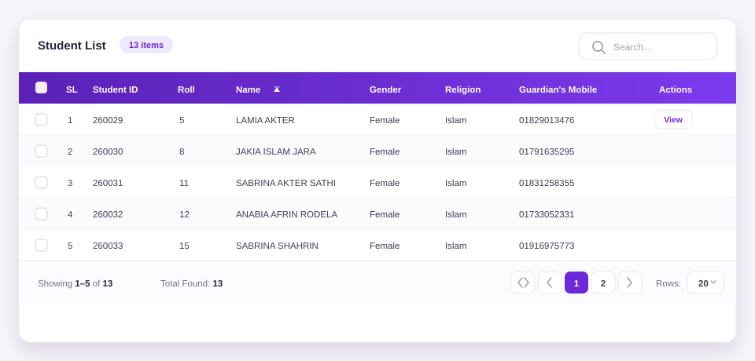

# @ithouse-bd/ngx-table — Documentation

Complete reference for `<ith-table>`: every input, output, template slot and recipe.

## Contents

- [Requirements](#requirements)
- [Installation](#installation)
- [Basic usage](#basic-usage)
- [Columns](#columns)
- [Sorting](#sorting)
- [Search and filters](#search-and-filters)
- [Pagination](#pagination)
- [Selection](#selection)
- [Row actions](#row-actions)
- [Custom templates](#custom-templates)
- [Loading and empty states](#loading-and-empty-states)
- [Server-side mode](#server-side-mode)
- [Programmatic API](#programmatic-api)
- [Accessibility](#accessibility)
- [Performance](#performance)
- [Troubleshooting](#troubleshooting)
- [Full input/output reference](#full-inputoutput-reference)



## Requirements

- Angular **20 or newer** (standalone components, signal inputs, `model()`)
- No CSS framework required; the component ships its own scoped styles

Install:

```bash
npm install @ithouse-bd/ngx-table
```

Import the component directly (recommended) or `NgxTableModule` for NgModule apps:

```typescript
import { TableComponent, TableCellDirective } from '@ithouse-bd/ngx-table';
```

> **Projected templates:** the `ithTableCell`, `ithTableHeader`, `ithTableFilter`,
> `ithTableRowActions`, `ithTableToolbar`, `ithTableFooter` and `ithTableEmpty` directives are
> used in *your*
> template, so import the ones you use into your component (or import `NgxTableModule`,
> which re-exports all of them).

## Basic usage

```typescript
interface Product {
  id: number;
  name: string;
  category: string;
  price: number;
  stock: number;
  active: boolean;
}

readonly columns: TableColumn<Product>[] = [
  { key: 'name', header: 'Product', minWidth: '200px' },
  { key: 'category', header: 'Category' },
  { key: 'price', header: 'Price', align: 'right', formatter: (v) => `$${Number(v).toFixed(2)}` },
  { key: 'stock', header: 'Stock', align: 'center' },
  { key: 'active', header: 'Active', formatter: (v) => (v ? 'Yes' : 'No') },
];
```

```html
<ith-table
  title="Products"
  countSuffix="products"
  [data]="products"
  [columns]="columns"
  [pageSize]="20">
</ith-table>
```

Defaults that matter:

| Option | Default |
| --- | --- |
| `mode` | `client` |
| `keyField` | `id` |
| `selectionMode` | `none` |
| `sortable` | `true` (per column) |
| `searchable` | `true` |
| `pageSize` | `10` |
| `pageSizeOptions` | `[10, 20, 50, 100]` |
| `hoverable` | `true` |
| `showToolbar` / `showFooter` | `true` |
| `showPagination` / `showPageSize` / `showFirstLast` | `true` |

## Columns

`TableColumn<T>` controls both data access and rendering:

| Field | Type | Description |
| --- | --- | --- |
| `key` | `string` | Unique id. Also the template name (`ithTableCell="key"`). |
| `header` | `string` | Header label; defaults to `key`. |
| `field` | `string` | Dot-path to the value, e.g. `customer.name`. Defaults to `key`. |
| `sortable` | `boolean` | Per-column override of the table-level `sortable`. |
| `searchable` | `boolean` | Include in global search (default `true`). |
| `filterable` | `boolean` | Show a control in the filter row (default `true`). |
| `filterType` | `'text' \| 'number' \| 'date' \| 'select'` | Control used by the filter (default `text`). |
| `filterOptions` | `{ label, value }[]` | Options of a `select` filter. |
| `filterPlaceholder` | `string` | Placeholder for this column's control. |
| `filterPredicate` | `(cellValue, filterValue, row) => boolean` | Custom matching rule (wins over `filterType`). |
| `align` | `'left' \| 'center' \| 'right'` | Header and cell alignment. |
| `width`, `minWidth` | `string` | CSS sizing, e.g. `'120px'`, `'20%'`. |
| `hidden` | `boolean` | Keep the config but hide the column. |
| `headerClass`, `cellClass` | `string` \| `(row, index) => string \| string[] \| object` | Extra classes. |
| `formatter` | `(value, row, index) => string \| number` | Display value; also used for search/filter matching. |
| `sortFn` | `(a: T, b: T) => number` | Custom ascending comparator. |
| `searchValue` | `(row: T) => string` | Custom text for the global search. |
| `filterValue` | `(row: T) => string` | Custom text for the column filter. |

Nested values work out of the box:

```typescript
{ key: 'name', field: 'customer.name', header: 'Customer' }
```

## Sorting

Clicking a sortable header cycles **ascending → descending → unsorted**. Bind `sort` for
two-way control or listen to `sortChange`:

```html
<ith-table
  [data]="rows"
  [columns]="columns"
  [sort]="sort"
  (sortChange)="sort = $event">
</ith-table>
```

```typescript
sort: TableSort | null = { key: 'price', direction: 'desc' };
```

`TableSort` is `{ key: string; direction: 'asc' | 'desc' }`. Disable sorting table-wide with
`[sortable]="false"`, or per column with `{ sortable: false }`.

### Custom comparators

```typescript
{
  key: 'priority',
  header: 'Priority',
  sortFn: (a, b) => priorityWeight[a.priority] - priorityWeight[b.priority],
}
```

Sorting compares raw values by default: numbers numerically, dates by time, strings with
`localeCompare` (`numeric: true`, case-insensitive).

## Search and filters

`searchable` (default `true`) renders a search input in the toolbar. It matches **any**
searchable column; searching is debounced by Angular change detection, not by a timer, so
bind `search` in server mode when you need throttling.

```html
<ith-table [data]="rows" [columns]="columns" [(search)]="term"></ith-table>
```

### Per-column filters

```html
<ith-table [data]="rows" [columns]="columns" [showFilters]="true"></ith-table>
```

A second header row appears with a control for **every column**. Each column decides what
it renders through `filterType`:

```typescript
const columns: TableColumn<Order>[] = [
  // text (default): keeps rows whose display text contains the input
  { key: 'customer', header: 'Customer' },
  { key: 'customer', field: 'customer.name', header: 'Customer', filterPlaceholder: 'Search…' },

  // number: exact match on the numeric value
  { key: 'quantity', header: 'Qty', filterType: 'number' },

  // date: exact match on yyyy-mm-dd
  { key: 'createdAt', field: 'createdAt', header: 'Created', filterType: 'date' },

  // select: exact match, rendered as a dropdown
  {
    key: 'status',
    header: 'Status',
    filterType: 'select',
    filterOptions: [
      { label: 'Paid', value: 'paid' },
      { label: 'Pending', value: 'pending' },
    ],
  },

  // custom matching: any rule you like
  {
    key: 'total',
    header: 'Total',
    filterType: 'number',
    filterPredicate: (value, term) => Number(value) >= Number(term), // “total ≥ term”
  },

  // no filter control at all
  { key: 'notes', header: 'Notes', filterable: false },
];
```

Select filters show an empty option labelled `[filterAllLabel]="'All'"`. Opt a column out
with `{ filterable: false }`, hide the whole row with `[showFilters]="false"` (the default),
or replace one control with your own template:

```html
<ng-template ithTableFilter="status" let-value let-setFn="setValue">
  <select class="my-filter" [value]="value" (change)="setFn($any($event.target).value)">
    <option value="">Everything</option>
    <option value="paid">Paid</option>
    <option value="pending">Pending</option>
  </select>
</ng-template>
```

Context: `$implicit`/`value` (current filter text), `column`, `setValue(value: string)`.
Projected templates are styled by **your** component, so give them their own classes.

Filters are exposed as `filters` (`Record<columnKey, string>`), two-way bindable, and as the
`filterChange` output:

```html
<ith-table [(filters)]="filters" (filterChange)="load()"></ith-table>
```

In **client mode** search and filters reset the table to page 1 automatically. In **server
mode** nothing is filtered locally and the table never moves the page on its own: it passes
the whole `filterChange` record to you, and your handler should reset the page while it
fetches the filtered page back.

The empty state offers a “Clear search & filters” action.

Matching rules: `text` matches the formatted cell text, `number` compares numerically
(`12`, `12.0` and `012` all match 12), `date` compares the calendar date so an ISO string
such as `2026-10-05T23:00:00Z` is never shifted by a time zone, and `select` matches the
option value exactly.

## Pagination

The footer shows `Showing 1–10 of 13`, the `totalLabel` count, a numbered page window,
first/previous/next/last buttons and a rows-per-page selector.

```html
<ith-table
  [data]="rows"
  [columns]="columns"
  [(page)]="page"
  [(pageSize)]="pageSize"
  [pageSizeOptions]="[5, 10, 25, 100]"
  [maxPageButtons]="7"
  (pageChange)="onPage($event)">
</ith-table>
```

`pageChange` emits the new page number, `pageSizeChange` the new page size. All three of
`page`, `pageSize` and `pageSizeOptions` can be bound; hide parts of the footer with
`[showPagination]="false"`, `[showPageSize]="false"` or `[showFirstLast]="false"`.

If data shrinks, the current page is clamped to the last available page automatically.

## Selection

```html
<ith-table
  [data]="rows"
  [columns]="columns"
  selectionMode="multi"
  [(selected)]="selected">
</ith-table>
```

| Input | Description |
| --- | --- |
| `selectionMode` | `'none'`, `'single'` or `'multi'` |
| `selectAllScope` | `'page'` (default) selects the visible page, `'all'` selects every filtered row |
| `selectOnRowClick` | Click anywhere on a row to toggle it (default `false`) |
| `keyField` | Row identity; selection survives sorting, filtering and paging by key |
| `selected` | Two-way bindable array of selected rows |

`selectedChange` emits the selected rows. Header checkbox reflects `allPageSelected()` and
shows an indeterminate state when only some rows of the page are selected.

Selection across pages is preserved by key. For server mode, keys are compared to the rows
currently in `selected`, so keep the objects you put there.

Public helpers: `toggleRow(row, checked)`, `toggleAll(checked)`, `selectRow(row)`,
`deselectRow(row)`, `clearSelection()`, `isSelected(row)`.

## Row actions

```typescript
readonly actions: TableRowAction<Order>[] = [
  { id: 'view', label: 'View', icon: '👁' },
  { id: 'ship', label: 'Ship', disabled: (row) => row.status !== 'paid', hidden: (row) => row.cancelled },
  { id: 'cancel', label: 'Cancel', class: 'is-danger' },
];
```

```html
<ith-table
  [data]="orders"
  [columns]="columns"
  [rowActions]="actions"
  actionsHeader="Actions"
  actionsWidth="180px"
  (actionClick)="onAction($event)">
</ith-table>
```

```typescript
onAction(event: TableActionEvent<Order>): void {
  const { action, row, index } = event;
  if (action.id === 'view') this.router.navigate(['/orders', row.id]);
}
```

The actions column is rendered only when `rowActions` is non-empty **or** a
`#ithTableRowActions` template exists. Buttons stop click propagation, so row clicks (and
`selectOnRowClick`) are not triggered.

## Custom templates

All templates are optional. Import the matching directives in your component.

### Cell — `ithTableCell="key"`

```html
<ng-template ithTableCell="status" let-row let-value="value" let-index="index">
  <span class="badge" [class.bg-success]="value === 'active'">{{ value }}</span>
</ng-template>
```

Context: `$implicit`/`row`, `column`, `value`, `index`.

### Header — `ithTableHeader="key"`

```html
<ng-template ithTableHeader="price" let-column="column">
  <span class="d-inline-flex align-items-center gap-1">
    {{ column.header }} <small class="text-muted">USD</small>
  </span>
</ng-template>
```

Context: `$implicit`/`column`.

### Filter control — `ithTableFilter="key"`

```html
<ng-template ithTableFilter="customer" let-value let-setFn="setValue" let-column="column">
  <input class="search" [value]="value" (input)="setFn($any($event.target).value)" />
</ng-template>
```

Context: `$implicit`/`value`, `column`, `setValue`. Changing the value behaves exactly like
the built-in control (server mode emits `filterChange`, page resets to 1).

### Row actions — `ithTableRowActions`

```html
<ng-template ithTableRowActions let-row let-index="index">
  <button type="button" class="btn btn-sm" (click)="edit(row)">Edit</button>
  <button type="button" class="btn btn-sm btn-danger" (click)="remove(row, index)">Delete</button>
</ng-template>
```

Context: `$implicit`/`row`, `index`.

### Toolbar — `ithTableToolbar`

Rendered next to the title and count badge:

```html
<ng-template ithTableToolbar let-total="total" let-selected="selected">
  <button class="btn btn-sm btn-primary" (click)="exportRows()">
    Export {{ total }}
  </button>
  @if (selected.length) {
    <button class="btn btn-sm btn-outline-danger" (click)="bulkDelete()">
      Delete {{ selected.length }}
    </button>
  }
</ng-template>
```

Context: `rows` (current page), `total`, `selected`, `search`.

### Footer — `ithTableFooter`

Replaces the default summary **only**; pagination controls stay. Context adds `page`,
`pageSize`, `pageCount`:

```html
<ng-template ithTableFooter let-page="page" let-page-count="pageCount" let-total="total">
  <span>Page {{ page }} of {{ pageCount }} — {{ total }} records</span>
</ng-template>
```

### Empty — `ithTableEmpty`

```html
<ng-template ithTableEmpty>
  <div class="text-center py-4">
    <p class="mb-2">Nothing here yet.</p>
    <button class="btn btn-primary" (click)="create()">Create the first record</button>
  </div>
</ng-template>
```

## Loading and empty states

```html
<ith-table
  [data]="rows"
  [columns]="columns"
  [loading]="loading()"
  loadingText="Fetching orders…"
  emptyText="No orders for this period">
</ith-table>
```

- With no rows, a spinner and `loadingText` replace the empty state.
- With rows, a translucent overlay keeps the current rows visible while loading.
- `hasQuery()` in the empty state switches the message to “No records match your search.”
  and offers a clear action.

## Server-side mode

```typescript
readonly pageRows = signal<Order[]>([]);
readonly total = signal(0);
readonly loading = signal(false);
readonly page = signal(1);
readonly pageSize = signal(10);
readonly sort = signal<TableSort | null>({ key: 'createdAt', direction: 'desc' });
readonly search = signal('');

constructor() {
  effect(() => {
    // Any query change triggers a reload; signals make this zoneless-safe.
    void this.fetch(this.page(), this.pageSize(), this.sort(), this.search());
  });
}

private async fetch(page: number, pageSize: number, sort: TableSort | null, search: string) {
  this.loading.set(true);
  const result = await this.api.orders({ page, pageSize, sort, search });
  this.pageRows.set(result.items);
  this.total.set(result.total);
  this.loading.set(false);
}
```

```html
<ith-table
  mode="server"
  [data]="pageRows()"
  [total]="total()"
  [loading]="loading()"
  [columns]="columns"
  [page]="page()"
  [pageSize]="pageSize()"
  [sort]="sort()"
  [search]="search()"
  (pageChange)="page.set($event)"
  (pageSizeChange)="pageSize.set($event); page.set(1)"
  (sortChange)="sort.set($event)"
  (searchChange)="search.set($event); page.set(1)">
</ith-table>
```

Notes:

- In server mode the table renders exactly `[data]`; it never slices or re-sorts.
- `[total]` drives the page count and the footer range. Fall back to `data.length` when it is `0`.
- The table owns the page in **client** mode only (query changes restart at page 1). In
  server mode reset `page` yourself in the `searchChange` / `filterChange` /
  `pageSizeChange` handlers — that keeps a query change to a single request.
- `selectAllScope="all"` can only select the rows you have loaded; for true “select all”
  keep a server-side flag instead.

## Programmatic API

```typescript
@ViewChild(TableComponent) table!: TableComponent<Order>;
```

| Method | Description |
| --- | --- |
| `goToPage(page)` | Clamp and navigate |
| `nextPage()` / `previousPage()` / `firstPage()` / `lastPage()` | Navigation helpers |
| `toggleSort(column)` | Cycle a column's sort state |
| `toggleRow(row, checked)` / `toggleAll(checked)` | Selection |
| `selectRow(row)` / `deselectRow(row)` / `clearSelection()` | Selection helpers |
| `isSelected(row)` / `rowKey(row)` | Selection inspection |
| `clearSearch()` / `clearFilters()` / `clearQuery()` | Reset search state |

Expose `sort`, `search`, `page`, `pageSize`, `selected` and `filters` publicly to reset
them from the parent.

## Accessibility

- Native `<table>`, `<thead>`/`<tbody>`, `<th scope="col">` markup.
- `aria-sort` on sortable headers (`ascending` / `descending` / `none`).
- Header and row checkboxes have explicit `aria-label`s; the header checkbox supports the
  indeterminate state.
- Pagination is a `<nav aria-label="Pagination">` with labelled first/previous/next/last
  buttons and `aria-current="page"` on the active page number.
- Sort headers and page buttons are real `<button>`s, so keyboard and screen readers work.
- Clickable rows (`rowClickable` / `selectOnRowClick`) are focusable and activate with
  `Enter` or `Space`, exactly like a mouse click.
- Selectable rows expose `aria-selected`; the header checkbox reflects “all on page” and
  the indeterminate state.
- `aria-busy` reflects `loading`, the loading/empty cell is `aria-live="polite"`, and
  `aria-label` names the table (`ariaLabel` input).
- `prefers-reduced-motion` disables row, button and input transitions.

## Performance

- Set `keyField` to a real unique field so `@for` tracks rows by key.
- Use `mode="server"` for large datasets instead of paging thousands of rows in the browser.
- Provide `track`-friendly stable row objects; the table never mutates your array.
- Avoid heavy work inside `formatter` / `cellClass` callbacks; they run per rendered cell.

## Troubleshooting

**Template directives are ignored / “not a known property”**
Import `TableCellDirective` (and friends) into the component that declares the template, or
import `NgxTableModule`.

**Styles don’t show up**
Component styles are scoped; do not set `encapsulation: ViewEncapsulation.None` on the
consumer and avoid `display: none` on the host. The table needs its host `display: block`.

**Angular budget warning for component styles**
The table stylesheet is ~15 kB uncompressed (~3 kB gzipped). If your Angular project uses
the default `anyComponentStyle` budget (8 kB), raise it:

```json
{
  "type": "anyComponentStyle",
  "maximumWarning": "16kb",
  "maximumError": "20kb"
}
```

**Page resets unexpectedly**
In client mode changing `search`, `filters`, `sort` or `pageSize` returns to page 1 on
purpose. In server mode the table never resets the page — if it jumps, your own handler
(or a clamped `page` after the total shrank) is doing it.

**Selection is lost after refetch (server mode)**
Rows are compared by `keyField`; pass the same row objects (or at least the same keys) in
`[(selected)]`, and don’t rebuild selected objects with different ids.

## Full input/output reference

### Inputs

| Input | Type | Default |
| --- | --- | --- |
| `data` | `T[]` | `[]` |
| `columns` | `TableColumn<T>[]` | `[]` |
| `keyField` | `string` | `'id'` |
| `mode` | `'client' \| 'server'` | `'client'` |
| `total` | `number` | `0` |
| `title` | `string` | `''` |
| `countSuffix` | `string` | `'items'` |
| `totalLabel` | `string` | `'Total Found'` |
| `ariaLabel` | `string` | `'Data table'` |
| `showToolbar` | `boolean` | `true` |
| `searchable` | `boolean` | `true` |
| `searchPlaceholder` | `string` | `'Search…'` |
| `showFilters` | `boolean` | `false` |
| `filterPlaceholder` | `string` | `'Filter…'` |
| `filterAllLabel` | `string` | `'All'` |
| `emptyText` | `string` | `'No records found'` |
| `sortable` | `boolean` | `true` |
| `sort` | `TableSort \| null` | `null` |
| `search` | `string` | `''` |
| `filters` | `Record<string, string>` | `{}` |
| `page` | `number` | `1` |
| `pageSize` | `number` | `10` |
| `pageSizeOptions` | `number[]` | `[10, 20, 50, 100]` |
| `showPagination` | `boolean` | `true` |
| `showPageSize` | `boolean` | `true` |
| `showFirstLast` | `boolean` | `true` |
| `maxPageButtons` | `number` | `5` |
| `showFooter` | `boolean` | `true` |
| `selectionMode` | `'none' \| 'single' \| 'multi'` | `'none'` |
| `selectAllScope` | `'page' \| 'all'` | `'page'` |
| `selected` | `T[]` | `[]` |
| `selectOnRowClick` | `boolean` | `false` |
| `rowActions` | `TableRowAction<T>[]` | `[]` |
| `actionsHeader` | `string` | `'Actions'` |
| `actionsWidth` | `string` | `'120px'` |
| `rowClickable` | `boolean` | `false` |
| `rowClass` | `(row, index) => string \| string[] \| Record<string, boolean>` | — |
| `loading` | `boolean` | `false` |
| `loadingText` | `string` | `'Loading…'` |
| `striped` | `boolean` | `false` |
| `hoverable` | `boolean` | `true` |
| `bordered` | `boolean` | `false` |
| `dense` | `boolean` | `false` |
| `stickyHeader` | `boolean` | `false` |
| `maxHeight` | `string` | `''` |

### Outputs

| Output | Payload |
| --- | --- |
| `sortChange` | `TableSort \| null` |
| `searchChange` | `string` |
| `filterChange` | `Record<string, string>` |
| `filtersChange` | `Record<string, string>` |
| `pageChange` | `number` |
| `pageSizeChange` | `number` |
| `selectedChange` | `T[]` |
| `actionClick` | `TableActionEvent<T>` (`{ action, row, index }`) |
| `rowClick` | `TableRowEvent<T>` (`{ row, index, event }`) |

## License

MIT © iTHouse
