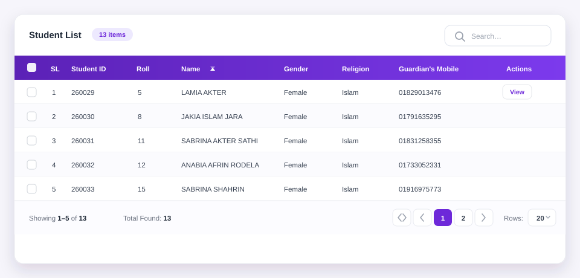
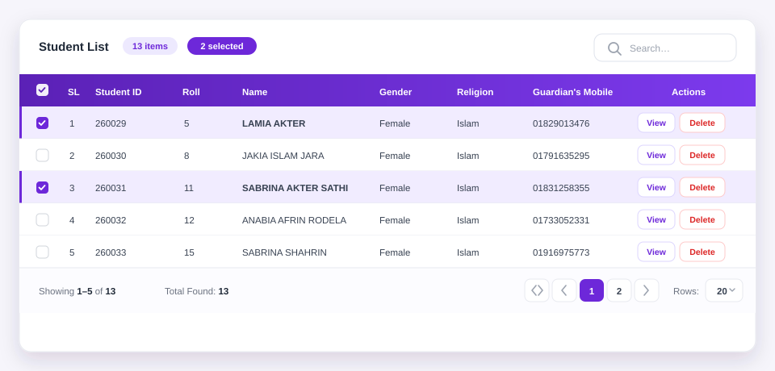

# @ithouse-bd/ngx-table

[](https://www.npmjs.com/package/@ithouse-bd/ngx-table)
[](https://www.npmjs.com/package/@ithouse-bd/ngx-table)
[](https://github.com/ithouse-bd/angular-libs/blob/main/libs/ngx-table/LICENSE)
[](https://angular.dev)

A generic, fully themeable data table for Angular. Bring your own row type and column
configuration — the table handles sorting, global search, per-column filters, pagination,
row selection, row actions and custom templates, for both client-side arrays and
API-driven (server) data.



```html
<ith-table title="Students" [data]="students" [columns]="columns" selectionMode="multi">
</ith-table>
```

## Features

- **Generic** — `TableColumn<T>` typed against your own row interface; dot-paths for nested data
- **Sorting** — click a header to cycle `asc → desc → unsorted`, custom comparators per column
- **Search** — global search box plus a filter row that covers **every column**: text,
  number, date or select controls, per-column placeholders, custom `filterPredicate`, or
  your own filter template
- **Pagination** — page window, first/last/prev/next, rows-per-page selector and range summary
- **Selection** — single or multi, select-all for the page or all filtered rows, keep keys across pages
- **Row actions** — declarative action buttons with icons, classes, disabled/hidden rules, or your own template
- **Custom templates** — cell, header, row actions, toolbar, footer and empty state
- **Server mode** — the table emits sort/search/filter/page changes; you supply one page of rows
- **Copy** — hover a cell (or press Ctrl/Cmd+C on a focused cell) or copy a whole row
- **Context menu** — right-click / `Shift+F10` emits `rowContextMenu` and renders your
  `ithTableRowMenu` template in a floating panel at the pointer
- **Layout control** — Columns popover, per-column header menu (sort, pin, fit, hide),
  drag-to-reorder headers and drag-to-resize edges; hidden columns, order, widths, pinning and
  density are saved in `localStorage` through `storageKey`, plus named views
- **Filter chips** — the active search term and every column filter shown as removable chips
- **Selection bar** — bulk actions appear as soon as rows are selected
- **CSV & Excel export** — one toolbar menu with a real `.xlsx` (built without dependencies)
  and `.csv`, plus `toCsv()` / `toExcel()` / `downloadCsv()` / `downloadExcel()`
- **Row detail** — an `#ithTableRowDetail` template expands underneath the row
- **Footer totals** — `sum`, `avg`, `min`, `max` and `count` per column
- **Keyboard grid** — one tab stop, arrow keys / Home / End / PageUp / PageDown, Space selects
- **Sticky columns** — stick the checkbox and actions columns, or pin any column at runtime
- **Cell tooltips** — full value on hover for truncated cells, opt out per column
- **Stable height** — `minRows` keeps the empty body space when a page returns fewer rows,
  so a one-row result never collapses into a single line
- **Skeleton loading** — placeholder rows instead of a blank table, plus a toolbar
  comfortable/compact density toggle
- **Presentation** — striped, bordered, dense, hover, sticky header, fixed max height, loading overlay
- **Theming** — CSS variables with light, dark and system (`auto`) modes; zero style-framework dependency
- **Signals everywhere** — `input()`, `model()`, `output()`, standalone component, zoneless-safe
- **No runtime dependencies** except `tslib`

## Compatibility

| | Supported |
| --- | --- |
| Angular 20 and newer | ✅ |
| Angular 17, 18, 19 | ❌ not supported (`>=20.0.0` peer range) |
| Standalone components | ✅ required |
| `NgModule` wrappers | ❌ removed (import the standalone components directly) |
| Zoneless change detection | ✅ (signals throughout) |
| SSR / prerendering | ✅ no direct DOM access |

## Installation

```bash
npm install @ithouse-bd/ngx-table
# or
yarn add @ithouse-bd/ngx-table
# or
pnpm add @ithouse-bd/ngx-table
```

**Angular 20 or newer is required.** `@angular/common` and `@angular/core` are peer
dependencies.

## Quick start

### 1. Describe your rows

```typescript
import { TableColumn } from '@ithouse-bd/ngx-table';

interface Student {
  id: number;
  name: string;
  email: string;
  roll: number;
  active: boolean;
}

readonly columns: TableColumn<Student>[] = [
  { key: 'roll', header: 'Roll', width: '80px', align: 'center' },
  { key: 'name', header: 'Name', minWidth: '180px' },
  { key: 'email', header: 'Email' },
  {
    key: 'active',
    header: 'Status',
    formatter: (value) => (value ? 'Active' : 'Inactive'),
  },
];
```

### 2. Render the table

```typescript
import { Component } from '@angular/core';
import { TableComponent } from '@ithouse-bd/ngx-table';

@Component({
  selector: 'app-students',
  imports: [TableComponent],
  template: `
    <ith-table
      title="Student List"
      [data]="students"
      [columns]="columns"
      selectionMode="multi"
      [pageSize]="10"
      (rowClick)="openStudent($event.row)">
    </ith-table>
  `,
})
export class StudentsComponent {}
```

The `keyField` defaults to `'id'`; set `[keyField]="'studentId'"` when your rows use another
unique field.

## Custom cell templates

Add `ithTableCell` templates for any column key. The context exposes `$implicit` (the row),
`row`, `column`, `value` and `index`:

```html
<ith-table [data]="students" [columns]="columns">
  <ng-template ithTableCell="name" let-row let-index="index">
    <strong>{{ index + 1 }}. {{ row.name }}</strong>
  </ng-template>

  <ng-template ithTableCell="active" let-value="value">
    <span [class.text-success]="value" [class.text-muted]="!value">
      {{ value ? 'Active' : 'Inactive' }}
    </span>
  </ng-template>
</ith-table>
```

Import the directive next to the table:

```typescript
import { TableCellDirective, TableComponent } from '@ithouse-bd/ngx-table';

@Component({ imports: [TableComponent, TableCellDirective], /* … */ })
```

Other slots: `ithTableHeader="key"`, `ithTableFilter="key"`, `ithTableRowActions`,
`ithTableToolbar`, `ithTableFooter`, `ithTableEmpty`, `ithTableRowMenu`.

## Copy, context menu & column preset

```html
<ith-table
  [data]="students"
  [columns]="columns"
  [copyable]="true"
  [showColumnPicker]="true"
  [showDensityToggle]="true"
  storageKey="students-table"
  [stickySelection]="true"
  [stickyActions]="true"
  (cellCopy)="onCopy($event)">

  <ng-template ithTableRowMenu let-row>
    <button type="button" (click)="open(row)">Open</button>
    <button type="button" (click)="remove(row)">Delete</button>
  </ng-template>
</ith-table>
```

- `copyable` adds a hover copy button per cell and lets Ctrl/Cmd+C copy the focused cell;
  `(cellCopy)` reports `{ value, row, index, column }`.
- Right-clicking a row (or `Shift+F10` / the context-menu key) emits `rowContextMenu` with the
  pointer position and renders the `ithTableRowMenu` template in a fixed panel that closes on
  outside click or `Escape`.
- `showColumnPicker` renders a "Columns" popover; the choice and the density toggle are
  persisted under `storageKey`, so a returning user gets the same layout.
- `stickySelection` / `stickyActions` keep the first and last columns visible while scrolling
  horizontally; `TableColumn.sticky` does the same for any other column (give it a `width`).
- `TableColumn.tooltip` (default `true`) puts the full text in the native `title`, which is
  what makes truncated cells readable on hover.



## Layout control, export & row detail

```html
<ith-table
  [data]="students"
  [columns]="columns"
  [showColumnPicker]="true"
  [resizable]="true"
  [reorderable]="true"
  [showViews]="true"
  [showExport]="true"
  [showFilters]="true"
  storageKey="students-table"
  [selectionActions]="bulkActions"
  (selectionAction)="bulk($event)"
  (columnStateChange)="saveLayout($event)">

  <ng-template ithTableRowDetail let-row>
    <p>{{ row.email }} — {{ row.guardianMobile }}</p>
  </ng-template>
</ith-table>
```

- **Header menu** — hovering a header shows a `⋮` button with sort asc/desc, pin left/right,
  unpin, fit to content and hide. `showColumnMenu` (default `true`) turns it off.
- **Resize & reorder** — `resizable` drags the column edge (minimum 56 px), `reorderable`
  drags a header onto another. Both changes are stored in the preset.
- **Named views** — `showViews` adds a Views menu: save the current layout under a name and
  apply it later. The layout itself is still restored automatically through `storageKey`.
- **Filter chips** — with an active search or filter the toolbar shows removable chips plus
  "Clear all". `showFilterChips` (default `true`) hides them.
- **Selection bar** — pass `selectionActions` and the bar appears whenever rows are selected;
  `(selectionAction)` emits `{ action, rows }`.
- **Row detail** — with an `#ithTableRowDetail` template each row gets a chevron
  (`rowDetailTrigger="button"`), or expands on row click (`"row"`).
- **CSV & Excel export** — `showExport` renders the button with a two-item menu:
  `.xlsx` (a real workbook with a bold frozen header row, autofilter and column widths,
  generated in the browser without any dependency) and `.csv` (UTF-8 with BOM).
  `toCsv()` / `toExcel()` return the data and `downloadCsv()` / `downloadExcel()` save it;
  selected rows win over the whole filtered set.
- **Footer totals** — add `aggregate: 'sum'` (or `avg`/`min`/`max`/`count`) to a column, or
  `aggregate: { type: 'avg', label: 'Average', format: (n) => n.toFixed(1) }`.
- **Keyboard** — the grid has a single tab stop: arrows move, `Home`/`End` jump within a row,
  `Ctrl+Home`/`Ctrl+End` to the corners, `PageUp`/`PageDown` move a page, `Space` selects the
  row and `Ctrl/Cmd+C` copies the focused cell.

## Row actions

```typescript
readonly actions: TableRowAction<Student>[] = [
  { id: 'edit', label: 'Edit', icon: '✎' },
  {
    id: 'delete',
    label: 'Delete',
    class: 'is-danger',
    disabled: (row) => row.active,
  },
];
```

```html
<ith-table
  [data]="students"
  [columns]="columns"
  [rowActions]="actions"
  (actionClick)="handleAction($event)">
</ith-table>
```

`$event` is `{ action, row, index }`. Use `#ithTableRowActions` for a completely custom
actions column.

## Server-side mode

```html
<ith-table
  mode="server"
  [data]="pageRows()"
  [total]="total()"
  [loading]="loading()"
  [columns]="columns"
  [page]="page()"
  [pageSize]="pageSize()"
  [sort]="sort()"
  [search]="search()"
  (pageChange)="onPage($event)"
  (pageSizeChange)="onPageSize($event)"
  (sortChange)="onSort($event)"
  (searchChange)="onSearch($event)"
  (filterChange)="onFilters($event)">
</ith-table>
```

In server mode the table does **not** re-sort, search or slice the array — it renders
exactly the rows you pass, asks for the rest through outputs, and uses `[total]` for the
pager. See the [full documentation](https://github.com/ithouse-bd/angular-libs/blob/main/libs/ngx-table/DOCUMENTATION.md)
for a complete example.

## Theming

One token adopts your application's brand colour — header, hover, selected rows, filters,
footer, focus ring and toolbar buttons all derive from it (light and dark):

```css
:root {
  --ith-table-brand: #0f766e;
}
```

Individual tokens are still available for finer control:

```css
.my-table {
  --ith-table-brand: #2563eb;
  --ith-table-header-text: #e2e8f0;
  --ith-table-radius: 8px;
}
```

Light/dark/auto follows the same convention as `@ithouse-bd/ngx-dropdown`: set
`data-theme="light" | "dark" | "auto"` on `<html>` or `<body>`. All variables are listed
in the [theming guide](https://github.com/ithouse-bd/angular-libs/blob/main/libs/ngx-table/THEMING.md).

The component ships ~36 kB of scoped CSS (~6 kB gzipped). If your `angular.json` keeps the
Angular default `anyComponentStyle` budget (8 kB error), raise it to `32kb`/`40kb`.

## API at a glance

| Input | Type | Default | Description |
| --- | --- | --- | --- |
| `data` | `T[]` | `[]` | Rows to render (current page in server mode) |
| `columns` | `TableColumn<T>[]` | `[]` | Column configuration |
| `keyField` | `string` | `'id'` | Unique key path used for selection and tracking |
| `mode` | `'client' \| 'server'` | `'client'` | Local or API-driven data |
| `total` | `number` | `0` | Total row count (server mode) |
| `selectionMode` | `'none' \| 'single' \| 'multi'` | `'none'` | Row selection |
| `selectAllScope` | `'page' \| 'all'` | `'page'` | What the header checkbox selects |
| `selected` | `T[]` | `[]` | Two-way bindable selection |
| `rowActions` | `TableRowAction<T>[]` | `[]` | Action buttons per row |
| `page` / `pageSize` | `number` | `1` / `10` | Two-way bindable pager state |
| `search` | `string` | `''` | Two-way bindable global search |
| `sort` | `TableSort \| null` | `null` | Two-way bindable sort state |
| `pageSizeOptions` | `number[]` | `[10, 20, 50, 100]` | Rows-per-page choices |
| `showFilters` | `boolean` | `false` | Per-column filter row (text / number / date / select) |
| `loading` | `boolean` | `false` | Loading overlay |
| `striped` / `bordered` / `dense` / `hoverable` | `boolean` | `false` / `false` / `false` / `true` | Presentation modifiers |
| `stickyHeader` / `maxHeight` | `boolean` / `string` | `false` / `''` | Scroll container behaviour |
| `minRows` | `number` | `4` | Empty body space kept when there are fewer rows |
| `showColumnMenu` | `boolean` | `true` | Header `⋮` menu (sort, pin, fit, hide) |
| `resizable` / `reorderable` | `boolean` | `false` | Drag to resize / reorder columns |
| `showViews` | `boolean` | `false` | Named-layout menu |
| `showExport` / `exportFileName` | `boolean` / `string` | `false` / `'table'` | CSV export button |
| `showFilterChips` | `boolean` | `true` | Removable chips for active filters |
| `selectionActions` | `TableSelectionAction<T>[]` | `[]` | Bulk actions in the selection bar |
| `rowDetailTrigger` | `'button' \| 'row' \| 'none'` | `'button'` | How `#ithTableRowDetail` expands |
| `keyboardNavigation` | `boolean` | `true` | Single tab stop + arrow keys |

Outputs: `sortChange`, `searchChange`, `filterChange`, `pageChange`, `pageSizeChange`,
`selectedChange`, `actionClick`, `rowClick`, `cellCopy`, `rowContextMenu`, `columnsChange`,
`densityChange`, `columnStateChange`, `selectionAction`, `csvExport`, `exportFile`.

Full reference, every template context and recipes:
**[DOCUMENTATION.md](https://github.com/ithouse-bd/angular-libs/blob/main/libs/ngx-table/DOCUMENTATION.md)**.

## Development

```bash
npx nx build ngx-table        # build the package into dist/libs/ngx-table
npx nx serve demo-app         # run the demo (client + server table examples)
```

## License

MIT © iTHouse
