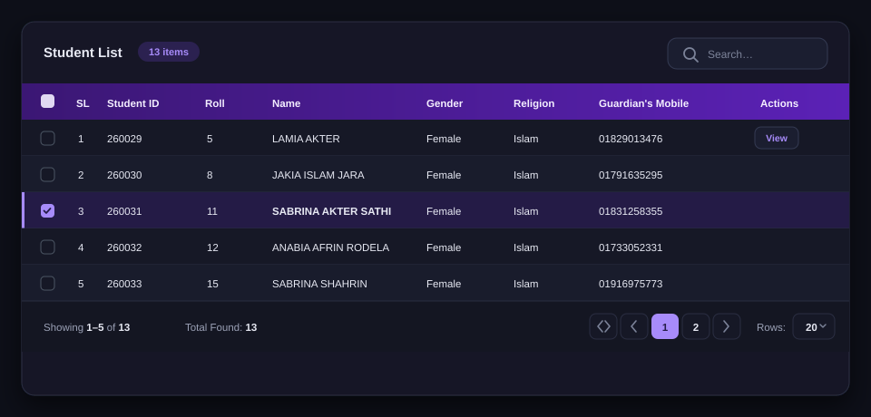
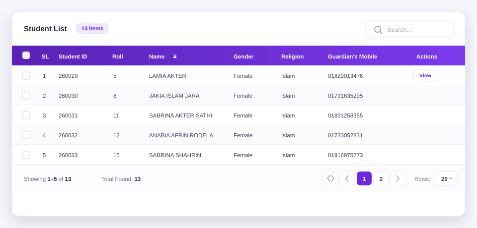

# Theming `<ith-table>`

The table is styled with scoped CSS and a single set of custom properties. Override the
properties on the component or on any ancestor to restyle everything — no selectors, no
`!important`, no CSS framework required.

## Contents

- [Theme modes](#theme-modes)
- [Quick start](#quick-start)
- [Variable reference](#variable-reference)
- [Ready-made themes](#ready-made-themes)
- [Presentation modifiers](#presentation-modifiers)
- [Scoping a theme](#scoping-a-theme)
- [Accessibility](#accessibility)

## Theme modes

The component follows the same convention as `@ithouse-bd/ngx-dropdown`:

| Attribute | Result |
| --- | --- |
| `data-theme="light"` (default) | Light palette |
| `data-theme="dark"` or `class="dark"` | Dark palette |
| `data-theme="auto"` | Follows `prefers-color-scheme` |

Set the attribute on `<html>` or `<body>` so the component can pick it up with
`:host-context()`:

```html
<html data-theme="dark">
  <body>
    <ith-table [data]="rows" [columns]="columns"></ith-table>
  </body>
</html>
```



Switching themes at runtime is a single attribute change:

```typescript
document.documentElement.setAttribute('data-theme', 'dark');
```

## Quick start

```css
/* app-wide */
ith-table {
  --ith-table-header-bg: #0f172a;
  --ith-table-header-text: #e2e8f0;
  --ith-table-accent: #2563eb;
  --ith-table-accent-soft: #dbeafe;
  --ith-table-radius: 8px;
  --ith-table-cell-padding: 10px 14px;
}
```

```html
<ith-table class="orders-table" [data]="orders" [columns]="columns"></ith-table>
```

```css
.orders-table {
  --ith-table-header-bg: #166534;
  --ith-table-accent: #16a34a;
  --ith-table-accent-soft: #dcfce7;
}
```

## Variable reference

All variables are defined on the `.ith-table` element.

### Surfaces & text

| Variable | Light | Dark | Description |
| --- | --- | --- | --- |
| `--ith-table-bg` | `#ffffff` | `#161826` | Card and row background |
| `--ith-table-text` | `#1f2937` | `#e7e9f3` | Cell and header-row text |
| `--ith-table-muted` | `#6b7280` | `#9aa0b5` | Footer text, placeholders, icons |
| `--ith-table-border` | `#e8eaf0` | `#2a2e42` | Borders and separators |
| `--ith-table-footer-bg` | `#fcfcff` | `#141622` | Footer background |
| `--ith-table-filter-bg` | `#faf9ff` | `#1a1d2e` | Filter row background |

### Header

| Variable | Light | Dark | Description |
| --- | --- | --- | --- |
| `--ith-table-header-bg` | `#5b21b6` | `#4c1d95` | Header bar background |
| `--ith-table-header-text` | `#ffffff` | `#f3eeff` | Header text and sort icons |

The header is a solid colour so it works with `stickyHeader`; use any CSS colour
(`#fff`, `rgb(...)`, `var(--brand)`).

### Accent & interaction

| Variable | Light | Dark | Description |
| --- | --- | --- | --- |
| `--ith-table-accent` | `#6d28d9` | `#a78bfa` | Active page, checkboxes, links, action text |
| `--ith-table-accent-soft` | `#ede9fe` | `#2b2150` | Badges, hover backgrounds |
| `--ith-table-hover` | `#f6f4ff` | `#1e2236` | Row hover |
| `--ith-table-selected-bg` | `#f1ecff` | `#241b46` | Selected row background |
| `--ith-table-striped-bg` | `#fbfbfe` | `#191c2c` | Zebra rows (`striped`) |
| `--ith-table-focus` | `rgba(109, 40, 217, 0.22)` | `rgba(167, 139, 250, 0.3)` | Focus ring (box-shadow) |

### Inputs

| Variable | Light | Dark | Description |
| --- | --- | --- | --- |
| `--ith-table-input-bg` | `#ffffff` | `#1b1e30` | Search and filter input background |
| `--ith-table-input-border` | `#dfe3ec` | `#343a52` | Input border |
| `--ith-table-overlay` | `rgba(255,255,255,.72)` | `rgba(17,19,30,.72)` | Loading overlay |

### Shape & spacing

| Variable | Default | Description |
| --- | --- | --- |
| `--ith-table-radius` | `14px` | Card border radius |
| `--ith-table-shadow` | soft shadow | Card shadow (`none` to remove) |
| `--ith-table-cell-padding` | `12px 16px` | Body cell padding |
| `--ith-table-font-size` | `14px` | Body font size |
| `--ith-table-header-font-size` | `13px` | Header font size |

## Ready-made themes

### Compact admin

```css
.admin-table {
  --ith-table-header-bg: #0f172a;
  --ith-table-header-text: #e2e8f0;
  --ith-table-accent: #2563eb;
  --ith-table-accent-soft: #dbeafe;
  --ith-table-hover: #f1f5f9;
  --ith-table-selected-bg: #e0ecff;
  --ith-table-radius: 8px;
  --ith-table-cell-padding: 8px 12px;
  --ith-table-font-size: 13px;
  --ith-table-shadow: none;
}
```

### Bootstrap-friendly

```css
[data-theme='bootstrap'] ith-table {
  --ith-table-header-bg: #f8f9fa;
  --ith-table-header-text: #212529;
  --ith-table-accent: #0d6efd;
  --ith-table-accent-soft: #cfe2ff;
  --ith-table-hover: #f8f9fa;
  --ith-table-selected-bg: #e7f1ff;
  --ith-table-border: #dee2e6;
  --ith-table-radius: 6px;
  --ith-table-shadow: none;
}
```

### Soft purple (default look)

```css
ith-table {
  --ith-table-header-bg: #5b21b6;
  --ith-table-accent: #6d28d9;
  --ith-table-accent-soft: #ede9fe;
  --ith-table-radius: 14px;
}
```

### Minimal

```css
.minimal-table {
  --ith-table-header-bg: #ffffff;
  --ith-table-header-text: #111827;
  --ith-table-border: #f1f5f9;
  --ith-table-accent: #111827;
  --ith-table-accent-soft: #f3f4f6;
  --ith-table-radius: 0;
  --ith-table-shadow: none;
  --ith-table-cell-padding: 10px 0;
}
```

## Presentation modifiers

Toggle these inputs instead of writing CSS:

| Input | Effect |
| --- | --- |
| `[striped]="true"` | Zebra rows |
| `[bordered]="true"` | Vertical cell borders |
| `[dense]="true"` | Tighter padding and smaller type |
| `[hoverable]="false"` | Disable row hover |
| `[stickyHeader]="true"` | Keep the header visible while scrolling |
| `[maxHeight]="'480px'"` | Scroll inside the table instead of the page |

```html
<ith-table
  [data]="rows"
  [columns]="columns"
  [dense]="true"
  [striped]="true"
  [stickyHeader]="true"
  maxHeight="480px">
</ith-table>
```

Default (light) rendering:



## Scoping a theme

Because the variables inherit, you can theme a single table (or a whole section):

```html
<section class="finance">
  <ith-table [data]="invoices" [columns]="columns"></ith-table>
</section>
```

```css
.finance ith-table {
  --ith-table-accent: #047857;
  --ith-table-accent-soft: #d1fae5;
  --ith-table-header-bg: #064e3b;
}
```

Keep the `ith-table` element `display: block` (its default) and give it a width; the
internal scroll container handles overflow on narrow screens.

## Accessibility

- Keep text/background contrast at WCAG AA. A dark header with light text and light rows
  with dark text is the safest combination.
- Do not remove focus rings: `--ith-table-focus` is used for inputs, buttons and pagination.
- Meaning conveyed by `--ith-table-accent` (selected rows, active page) is also available
  through checkboxes and `aria-current`, so colour is never the only signal.
- Respect `prefers-reduced-motion`; the component already disables transitions where needed.
